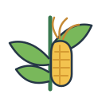
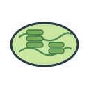

# Scientific SVG Icons

**A curated library of editable SVG icons for scientific illustration and visualization.**

面向科研绘图与科学可视化的可编辑 SVG 图标库，集中整理植物生物学、分子生物学、组学分析、实验设备及科研机制图素材。

- **Repository:** [omixcore/scientific-svg-icons](https://github.com/omixcore/scientific-svg-icons)
- **Version:** `0.0.1`
- **Primary format:** SVG
- **Language:** English / 中文

## Overview | 项目简介

This repository provides standalone, editable SVG icons for scientific figures, graphical abstracts, pathway diagrams, experimental workflows, presentations, and research software interfaces.

本仓库用于长期保存和维护独立、可编辑的科研 SVG 图标，可用于论文主图、图形摘要、代谢通路、实验流程、学术汇报及科研软件界面。

Figdraw 4, 灵匠可视, and similar platforms may serve as references for visual organization and discoverability. Their proprietary assets must not be copied or redistributed without explicit permission.

Figdraw 4、灵匠可视等平台可作为素材检索和视觉组织方式的参考；未经明确授权，不得直接复制或再分发其专有素材。

## Categories | 分类

| Directory | 内容 |
| --- | --- |
| `icons/biology/plants/` | Plants, leaves, maize, seedlings / 植物、叶片、玉米、幼苗 |
| `icons/biology/cells/` | Cells and organelles / 细胞与细胞器 |
| `icons/biology/molecules/` | DNA, RNA, proteins / DNA、RNA、蛋白质 |
| `icons/omics/sequencing/` | Sequencing and omics / 测序与组学 |
| `icons/experiments/` | Microscopy and lab equipment / 显微观察与实验器材 |
| `icons/diagrams/pathways/` | Pathway and interaction symbols / 通路与调控符号 |
| `metadata/` | Icon index and licensing records / 图标索引与授权记录 |

## Starter collection | 初始图标

The initial set contains original, editable SVG draft icons created for this repository. They are design starting points, not substitutes for scientifically precise structures or experimental data.

初始图标为本仓库制作的原创可编辑 SVG 草稿，可作为科研绘图的设计起点，但不能替代精确的科学结构或实验数据。

### Plants | 植物

| Leaf | Maize | Seedling |
| --- | --- | --- |
|  |  |  |

### Cells and molecules | 细胞与分子

| Cell | Chloroplast | DNA |
| --- | --- | --- |
|  |  |  |

| RNA | Protein |
| --- | --- |
|  |  |

### Experiments and omics | 实验与组学

| Microscope | Micropipette | PCR tube | Sequencer |
| --- | --- | --- | --- |
|  |  |  |  |

### Pathway symbols | 通路符号

| Activation | Inhibition |
| --- | --- |
|  |  |

## SVG conventions | SVG 规范

- Use standalone SVG files with a clear `viewBox`; do not embed raster images.
- Keep paths, labels, and groups editable whenever practical.
- Avoid external fonts, remote stylesheets, scripts, and linked resources.
- Use descriptive English filenames in lowercase kebab-case.
- Include an accessible `<title>` and, where useful, a `<desc>`.
- Keep visual styles coherent within an icon family and preserve scientific accuracy.

- 使用独立 SVG 文件，并设置清晰的 `viewBox`；不要嵌入位图。
- 尽可能保持路径、文字和图层可编辑。
- 不依赖外部字体、远程样式表、脚本或外链资源。
- 文件名使用有意义的英文小写 kebab-case 格式。
- 添加可访问的 `<title>`，必要时添加 `<desc>`。
- 同一系列图标保持风格协调，并保证科学准确性。

## Naming and metadata | 命名与元数据

Each icon must be registered in `metadata/icon-index.csv` with its category, source, creator, license, and review status.

每个图标都应登记在 `metadata/icon-index.csv` 中，记录分类、来源、创作者、授权方式和审核状态。

Recommended filename pattern: `<subject>-<variant>.svg`.

## Source and licensing | 来源与授权

**Public visibility does not automatically grant permission to reuse or redistribute every asset.**

仓库公开不代表其中所有素材自动获得可再利用或再分发许可。

- Original project artwork must be identified as original.
- Third-party icons must include source URL, creator, license, and required attribution.
- Do not add assets copied from Figdraw, 灵匠可视, or other platforms unless their terms explicitly permit redistribution.
- Assets marked `not-assigned` are awaiting a licensing decision.
- No repository-wide license has been selected yet.

- 原创素材应明确标记为原创。
- 第三方图标必须记录来源链接、创作者、许可证及必要署名。
- 除非平台条款明确允许再分发，否则不得将 Figdraw、灵匠可视或其他平台的素材直接加入仓库。
- 标记为 `not-assigned` 的素材尚未确定授权。
- 本仓库尚未设置统一许可证。

## Contributing | 贡献规范

See [CONTRIBUTING.md](CONTRIBUTING.md) before adding or updating icons.

新增或修改图标前，请先阅读 [CONTRIBUTING.md](CONTRIBUTING.md)。

## Version | 版本

Current version: **0.0.1**
