# Scientific SVG Icons

**A curated library of editable SVG icons for scientific illustration and visualization.**

面向科研绘图与科学可视化的可编辑 SVG 图标库，集中整理植物生物学、分子生物学、组学分析、实验设备及科研机制图素材。

- **Repository:** [omixcore/scientific-svg-icons](https://github.com/omixcore/scientific-svg-icons)
- **Version:** `0.0.1`
- **Primary format:** SVG
- **Language:** English / 中文
- **Icon index:** [metadata/icon-index.csv](metadata/icon-index.csv)

## Overview | 项目简介

This repository provides standalone, editable SVG icons for scientific figures, graphical abstracts, pathway diagrams, experimental workflows, presentations, and research software interfaces.

本仓库用于长期保存和维护独立、可编辑的科研 SVG 图标，可用于论文主图、图形摘要、代谢通路、实验流程、学术汇报及科研软件界面。

Figdraw 4, 灵匠可视, and similar platforms may serve as references for visual organization and discoverability. Their proprietary assets must not be copied or redistributed without explicit permission.

Figdraw 4、灵匠可视等平台可作为素材检索和视觉组织方式的参考；未经明确授权，不得直接复制或再分发其专有素材。

## Categories | 分类

| Directory | 内容 |
| --- | --- |
| `icons/biology/plants/` | Plants, leaves, maize, seedlings / 植物、叶片、玉米、幼苗 |
| `icons/biology/anatomy/` | Stomata, epidermis, roots, vascular bundles / 气孔、表皮、根及维管束 |
| `icons/biology/photosynthesis/` | Photosystems, carbon fixation, C4 and photorespiration / 光系统、碳固定、C4 与光呼吸 |
| `icons/biology/molecular-assays/` | CRISPR, Y1H, EMSA, Dual-LUC, BiFC, Co-IP / 分子实验方法 |
| `icons/biology/genetics/` | Chromosomes, loci, haplotypes, mutants, crosses / 染色体、位点、单倍型、突变及杂交 |
| `icons/biology/tissues/` | Leaf anatomy, mesophyll, bundle sheath, vascular tissues / 叶片解剖、叶肉、维管束鞘及维管组织 |
| `icons/biology/chloroplasts/` | Chloroplast ultrastructure and thylakoid components / 叶绿体超微结构与类囊体组分 |
| `icons/biology/gene-expression/` | Transcription, translation, promoter regulation / 转录、翻译及启动子调控 |
| `icons/biology/cells/` | Cells and organelles / 细胞与细胞器 |
| `icons/biology/molecules/` | DNA, RNA, proteins / DNA、RNA、蛋白质 |
| `icons/omics/proteomics/` | Mass spectrometry, spectra, heatmaps, gels / 质谱、谱图、热图及凝胶 |
| `icons/omics/metabolomics/` | LC-MS, extraction, chromatograms, networks / 液质联用、提取、色谱图及代谢网络 |
| `icons/omics/sequencing/` | Sequencing instruments / 测序设备 |
| `icons/omics/analysis/` | PCA, UMAP, GWAS, QTL, WGCNA, GSEA, PPI / 组学分析图示 |
| `icons/experiments/` | Microscopy and laboratory equipment / 显微观察与实验室设备 |
| `icons/diagrams/pathways/` | Pathway and interaction symbols / 通路与调控符号 |
| `icons/diagrams/workflows/` | Experimental and bioinformatics workflows / 实验及生物信息学流程 |
| `icons/biology/plant-morphology/` | Crop organs and morphology / 作物器官与形态 |
| `icons/experiments/plant-phenotyping/` | Plant experimental setups / 植物实验场景 |
| `icons/biology/molecular-components/` | Molecular mechanism components / 分子机制组件 |
| `icons/experiments/reporter-assays/` | Reporter and molecular assay illustrations / 报告基因与分子实验 |
| `icons/experiments/plant-tissue-culture/` | Plant tissue culture / 植物组织培养 |
| `icons/experiments/microscopy-components/` | Microscopy and specimen preparation / 显微成像与样品制备 |
| `icons/experiments/plant-physiology/` | Plant physiology and salt stress assays / 植物生理与盐胁迫实验 |
| `metadata/` | Icon index and licensing records / 图标索引与授权记录 |

## Featured icon sets | 重点图标集

### Plant anatomy | 植物组织与解剖

| Leaf cross-section | Mesophyll cell | Bundle sheath cell | Vascular bundle |
| --- | --- | --- | --- |
| 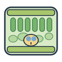 |  |  | 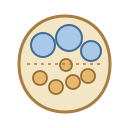 |

Additional icons: [Xylem vessel](icons/biology/tissues/xylem-vessel.svg) · [Phloem sieve tube](icons/biology/tissues/phloem-sieve-tube.svg)

### Chloroplasts | 叶绿体

[Chloroplast ultrastructure](icons/biology/chloroplasts/chloroplast-ultrastructure.svg) · [Granum stack](icons/biology/chloroplasts/granum-stack.svg) · [Thylakoid membrane](icons/biology/chloroplasts/thylakoid-membrane.svg)

### Gene expression | 基因表达

[Gene expression](icons/biology/gene-expression/gene-expression.svg) · [Transcription](icons/biology/gene-expression/transcription.svg) · [Translation](icons/biology/gene-expression/translation.svg) · [Promoter regulation](icons/biology/gene-expression/promoter-regulation.svg)

### Proteomics | 蛋白质组学

[Mass spectrometer](icons/omics/proteomics/mass-spectrometer.svg) · [Peptide spectrum](icons/omics/proteomics/peptide-spectrum.svg) · [Protein heatmap](icons/omics/proteomics/protein-heatmap.svg) · [Gel electrophoresis](icons/omics/proteomics/gel-electrophoresis.svg)

### Metabolomics | 代谢组学

[LC-MS system](icons/omics/metabolomics/lc-ms-system.svg) · [Metabolite extraction](icons/omics/metabolomics/metabolite-extraction.svg) · [Chromatogram](icons/omics/metabolomics/chromatogram.svg) · [Metabolite network](icons/omics/metabolomics/metabolite-network.svg)

### Laboratory equipment | 实验仪器

[Centrifuge](icons/experiments/lab-equipment/centrifuge.svg) · [Microcentrifuge tube](icons/experiments/lab-equipment/microcentrifuge-tube.svg) · [Petri dish](icons/experiments/lab-equipment/petri-dish.svg) · [Growth chamber](icons/experiments/growth-chamber.svg)

[Erlenmeyer flask](icons/experiments/lab-equipment/erlenmeyer-flask.svg) · [Micropipette](icons/experiments/lab-equipment/micropipette.svg) · [Analytical balance](icons/experiments/lab-equipment/analytical-balance.svg) · [Vertical autoclave](icons/experiments/lab-equipment/vertical-autoclave.svg)

### Workflows | 科研流程

[Sample-to-omics](icons/diagrams/workflows/sample-to-omics.svg) · [RNA-seq workflow](icons/diagrams/workflows/rna-seq-workflow.svg) · [Multi-omics integration](icons/diagrams/workflows/multi-omics-integration.svg) · [Bioinformatics pipeline](icons/diagrams/workflows/bioinformatics-pipeline.svg)

## Professional scientific schematics | 专业科研示意素材

This collection adds editable original SVG schematics for plant anatomy, photosynthesis, molecular assays, omics analysis, and plant genetics. They are conceptual illustrations, not microscopy images, measured plots, or substitutes for experiment-specific data.

本系列新增植物解剖、光合作用、分子实验、组学分析和植物遗传学原创可编辑 SVG 示意图。它们用于解释概念，不代表显微实拍、真实统计结果或特定实验数据。

### Plant anatomy | 植物解剖

- [Stomatal complex](icons/biology/anatomy/stomatal-complex.svg) · [Guard cells](icons/biology/anatomy/guard-cells.svg) · [Leaf epidermal cells](icons/biology/anatomy/epidermal-cells.svg)
- [Vascular bundle cross-section](icons/biology/anatomy/vascular-bundle-cross-section.svg) · [Root tip](icons/biology/anatomy/root-tip.svg) · [Root hair cell](icons/biology/anatomy/root-hair-cell.svg)

### Photosynthesis | 光合作用

- [Photosystem II](icons/biology/photosynthesis/photosystem-ii.svg) · [Photosystem I](icons/biology/photosynthesis/photosystem-i.svg) · [Rubisco](icons/biology/photosynthesis/rubisco.svg)
- [Calvin-Benson cycle](icons/biology/photosynthesis/calvin-cycle.svg) · [C4 carbon-concentrating mechanism](icons/biology/photosynthesis/c4-carbon-concentrating-mechanism.svg) · [Photorespiration](icons/biology/photosynthesis/photorespiration.svg)

### Molecular assays | 分子实验

- [CRISPR-Cas9](icons/biology/molecular-assays/crispr-cas9.svg) · [Yeast one-hybrid](icons/biology/molecular-assays/yeast-one-hybrid.svg) · [EMSA](icons/biology/molecular-assays/emsa.svg)
- [Dual-luciferase](icons/biology/molecular-assays/dual-luciferase.svg) · [BiFC](icons/biology/molecular-assays/bifc.svg) · [Co-IP](icons/biology/molecular-assays/co-immunoprecipitation.svg)

### Omics analysis | 组学分析

- [PCA](icons/omics/analysis/pca-plot.svg) · [UMAP](icons/omics/analysis/umap-plot.svg) · [GWAS Manhattan plot](icons/omics/analysis/gwas-manhattan.svg)
- [QTL interval](icons/omics/analysis/qtl-interval.svg) · [WGCNA](icons/omics/analysis/wgcna-network.svg) · [GSEA](icons/omics/analysis/gsea-enrichment.svg) · [PPI](icons/omics/analysis/ppi-network.svg)

### Plant genetics | 植物遗传学

- [Chromosome](icons/biology/genetics/chromosome.svg) · [Gene locus](icons/biology/genetics/gene-locus.svg) · [Haplotype block](icons/biology/genetics/haplotype-block.svg)
- [Loss-of-function mutant](icons/biology/genetics/loss-of-function-mutant.svg) · [Genetic cross](icons/biology/genetics/genetic-cross.svg)

## SVG conventions | SVG 规范

- Use standalone SVG files with a clear `viewBox`; do not embed raster images.
- Keep paths, labels, and groups editable whenever practical.
- Avoid external fonts, remote stylesheets, scripts, and linked resources.
- Use descriptive English filenames in lowercase kebab-case.
- Include an accessible `<title>` and, where useful, a `<desc>`.
- Keep visual styles coherent within an icon family and preserve scientific accuracy.
- Schematic tissue and organelle drawings are illustrative and should not be treated as microscopy-derived measurements.

- 使用独立 SVG 文件，并设置清晰的 `viewBox`；不要嵌入位图。
- 尽可能保持路径、文字和图层可编辑。
- 不依赖外部字体、远程样式表、脚本或外链资源。
- 文件名使用有意义的英文小写 kebab-case 格式。
- 添加可访问的 `<title>`，必要时添加 `<desc>`。
- 同一系列图标保持风格协调，并保证科学准确性。
- 组织和细胞器示意图仅用于视觉表达，不应视为显微测量结果。

## Naming and metadata | 命名与元数据

Each icon must be registered in `metadata/icon-index.csv` with its category, source, creator, license, and review status.

每个图标都应登记在 `metadata/icon-index.csv` 中，记录分类、来源、创作者、授权方式和审核状态。

Recommended filename pattern: `<subject>-<variant>.svg`.

## Source and licensing | 来源与授权

**Public visibility does not automatically grant permission to reuse or redistribute every asset.**

仓库公开不代表其中所有素材自动获得可再利用或再分发许可。

- Original project artwork must be identified as original.
- Third-party icons must include source URL, creator, license, and required attribution.
- Do not add assets copied from Figdraw, 灵匠可视, or other platforms unless their terms explicitly permit redistribution.
- Assets marked `not-assigned` are awaiting a licensing decision.
- No repository-wide license has been selected yet.

- 原创素材应明确标记为原创。
- 第三方图标必须记录来源链接、创作者、许可证及必要署名。
- 除非平台条款明确允许再分发，否则不得将 Figdraw、灵匠可视或其他平台的素材直接加入仓库。
- 标记为 `not-assigned` 的素材尚未确定授权。
- 本仓库尚未设置统一许可证。

## Contributing | 贡献规范

See [CONTRIBUTING.md](CONTRIBUTING.md) before adding or updating icons.

新增或修改图标前，请先阅读 [CONTRIBUTING.md](CONTRIBUTING.md)。

## Version | 版本

Current version: **0.0.1**

## Gene diagram components | 基因结构示意组件

Editable schematic elements for assembling gene models and regulatory diagrams. These are conceptual and not to scale; positions and interpretations depend on the experiment. 可编辑组件用于组合基因结构和调控示意图，图形不按比例，具体位置及生物学含义需结合实验确定。

| Cis-regulatory motif | Coding sequence | Enhancer |
| --- | --- | --- |
|  |  | [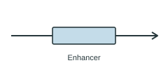](icons/diagrams/gene-elements/enhancer.svg) |

| Exon | 5′ untranslated region | Intron |
| --- | --- | --- |
| [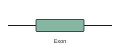](icons/diagrams/gene-elements/exon.svg) | [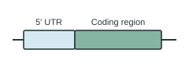](icons/diagrams/gene-elements/five-prime-utr.svg) | [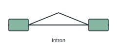](icons/diagrams/gene-elements/intron.svg) |

| Polyadenylation site | Promoter | Sequence deletion |
| --- | --- | --- |
|  | [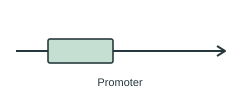](icons/diagrams/gene-elements/promoter.svg) |  |

| Sequence insertion | Silencer | Single-nucleotide substitution |
| --- | --- | --- |
|  |  | [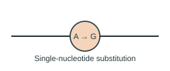](icons/diagrams/gene-elements/single-nucleotide-substitution.svg) |

| Splice acceptor site | Splice donor site | Tandem repeat |
| --- | --- | --- |
|  |  | [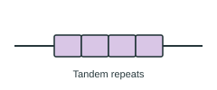](icons/diagrams/gene-elements/tandem-repeat.svg) |

| Transcription terminator | 3′ untranslated region | Transcription factor binding |
| --- | --- | --- |
|  | [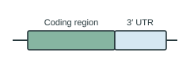](icons/diagrams/gene-elements/three-prime-utr.svg) |  |

| Transcription start site |  |  |
| --- | --- | --- |
|  |  |  |

### Revised plant anatomy | 更新的植物解剖图

[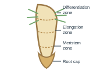](icons/biology/anatomy/root-tip.svg)

## Cellular components | 细胞与亚细胞组分

Editable conceptual components for plant-cell and molecular-mechanism figures; structures are schematic and not to scale. 可编辑的植物细胞及分子机制图组件；结构为示意图，不代表真实比例。

| Actin filament / 肌动蛋白丝 | Central vacuole / 中央液泡 | Golgi apparatus / 高尔基体 | Lipid droplet / 脂滴 |
| --- | --- | --- | --- |
|  |  |  |  |

| Microtubule / 微管 | Mitochondrion / 线粒体 | Nuclear pore complex / 核孔复合体 | Nucleolus / 核仁 |
| --- | --- | --- | --- |
| [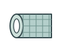](icons/biology/cellular-components/microtubule.svg) | [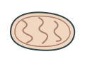](icons/biology/cellular-components/mitochondrion.svg) | [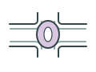](icons/biology/cellular-components/nuclear-pore.svg) |  |

| Nucleus / 细胞核 | Peroxisome / 过氧化物酶体 | Plant cell wall / 植物细胞壁 | Plasma membrane / 质膜 |
| --- | --- | --- | --- |
| [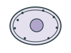](icons/biology/cellular-components/nucleus.svg) | [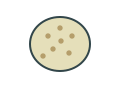](icons/biology/cellular-components/peroxisome.svg) | [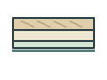](icons/biology/cellular-components/plant-cell-wall.svg) | [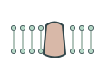](icons/biology/cellular-components/plasma-membrane.svg) |

| Plasmodesma / 胞间连丝 | Proteasome / 蛋白酶体 | Ribosome / 核糖体 | Rough endoplasmic reticulum / 粗面内质网 |
| --- | --- | --- | --- |
| [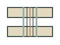](icons/biology/cellular-components/plasmodesma.svg) | [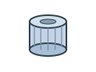](icons/biology/cellular-components/proteasome.svg) | [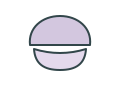](icons/biology/cellular-components/ribosome.svg) | [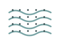](icons/biology/cellular-components/rough-endoplasmic-reticulum.svg) |

| Smooth endoplasmic reticulum / 光面内质网 | Starch granule / 淀粉粒 | Tonoplast / 液泡膜 | Transport vesicle / 运输囊泡 |
| --- | --- | --- | --- |
|  | [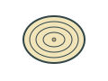](icons/biology/cellular-components/starch-granule.svg) | [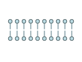](icons/biology/cellular-components/tonoplast.svg) |  |

## Stress and signaling | 逆境与信号转导

Editable conceptual symbols for environmental stress, cellular responses, and generic signaling. Depicted structures are schematic; tailor ion direction, species, and biological context to the experiment. 可编辑的环境逆境、细胞响应及信号转导示意组件；离子运输方向、物种和具体生物学含义应依据实验调整。

| Antioxidant defense / 抗氧化防御 | Cold stress / 低温胁迫 | Drought stress / 干旱胁迫 | Dry soil / 干旱土壤 |
| --- | --- | --- | --- |
|  |  | [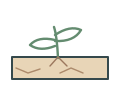](icons/biology/stress-signaling/drought-stress.svg) | [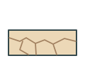](icons/biology/stress-signaling/dry-soil.svg) |

| Waterlogged soil / 渍水土壤 | Fungal hypha / 真菌菌丝 | Heat stress / 高温胁迫 | High light / 强光 |
| --- | --- | --- | --- |
| [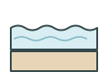](icons/biology/stress-signaling/flooded-soil.svg) | [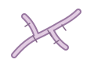](icons/biology/stress-signaling/fungal-hypha.svg) | [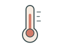](icons/biology/stress-signaling/heat-stress.svg) |  |

| Hypoxia / 低氧胁迫 | Membrane ion channel / 膜离子通道 | Mechanical wounding / 机械损伤 | Membrane receptor / 膜受体 |
| --- | --- | --- | --- |
| [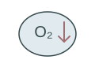](icons/biology/stress-signaling/hypoxia.svg) | [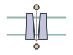](icons/biology/stress-signaling/ion-channel.svg) |  |  |

| Osmotic stress / 渗透胁迫 | Bacterial cell / 细菌细胞 | Protein phosphorylation / 蛋白磷酸化 | Reactive oxygen species / 活性氧 |
| --- | --- | --- | --- |
| [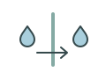](icons/biology/stress-signaling/osmotic-stress.svg) | [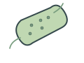](icons/biology/stress-signaling/pathogenic-bacterium.svg) | [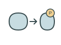](icons/biology/stress-signaling/protein-phosphorylation.svg) |  |

| Saline soil / 盐胁迫土壤 | Transcriptional response / 转录响应 | UV exposure / 紫外线胁迫 | Virus particle / 病毒颗粒 |
| --- | --- | --- | --- |
| [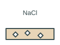](icons/biology/stress-signaling/soil-salinity.svg) | [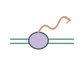](icons/biology/stress-signaling/transcriptional-response.svg) |  |  |

## Laboratory supplies | 实验耗材

Editable illustrations of common laboratory supplies and plant-sample handling equipment. These are schematic, not product-specific or to scale. 可编辑的实验耗材和植物样品处理工具示意图，不对应特定产品或真实比例。

| Conical centrifuge tube / 锥形离心管 | Cryogenic vial / 冻存管 | Folded filter paper / 折叠滤纸 | Graduated cylinder / 量筒 |
| --- | --- | --- | --- |
|  |  |  |  |

| Laboratory beaker / 实验室烧杯 | Laboratory forceps / 实验镊子 | Laboratory funnel / 实验漏斗 | Laboratory scalpel / 手术刀 |
| --- | --- | --- | --- |
|  |  |  |  |

| Laboratory scissors / 实验剪刀 | Liquid nitrogen dewar / 液氮杜瓦瓶 | Microscope slide / 载玻片 | Mortar and pestle / 研钵和研杵 |
| --- | --- | --- | --- |
|  |  |  |  |

| Multiwell plate / 多孔板 | PCR tube strip / PCR 八联管 | Pipette tip rack / 移液枪头盒 | Reagent bottle / 试剂瓶 |
| --- | --- | --- | --- |
|  |  |  |  |

| Seed envelope / 种子纸袋 | Serological pipette / 血清移液管 | Microtube rack / 离心管架 | Wash bottle / 洗瓶 |
| --- | --- | --- | --- |
|  |  |  |  |

## Plant morphology | 植物形态

Editable conceptual illustrations; biological details and experimental interpretation should be checked for the specific species or assay. 可编辑示意素材；具体结构和实验含义应结合物种及实验核对。

| Arabidopsis rosette / 拟南芥莲座叶 | Open cotton boll / 吐絮棉铃 | Foxtail millet panicle / 谷子穗 | Germinating maize kernel / 萌发玉米籽粒 |
| --- | --- | --- | --- |
|  |  | [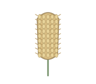](icons/biology/plant-morphology/foxtail-millet-panicle.svg) | [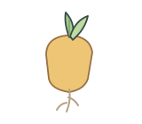](icons/biology/plant-morphology/germinating-maize-kernel.svg) |

| Lateral root emergence / 侧根发生 | Leaf disc / 叶圆片 | Legume root nodules / 豆科植物根瘤 | Maize crown root system / 玉米冠根 |
| --- | --- | --- | --- |
| [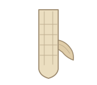](icons/biology/plant-morphology/lateral-root-emergence.svg) |  |  | [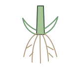](icons/biology/plant-morphology/maize-crown-root-system.svg) |

| Maize ear with exposed kernels / 玉米果穗 | Maize ear silk / 玉米花丝 | Maize kernel / 玉米籽粒 | Maize kernel longitudinal section / 玉米籽粒纵切面 |
| --- | --- | --- | --- |
| [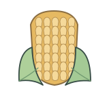](icons/biology/plant-morphology/maize-ear.svg) |  | [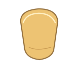](icons/biology/plant-morphology/maize-kernel.svg) |  |

| Maize leaf with parallel veins / 玉米叶片平行叶脉 | Maize pollen grain / 玉米花粉粒 | Maize tassel / 玉米雄穗 | Maize plant / 玉米植株 |
| --- | --- | --- | --- |
|  | [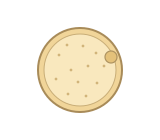](icons/biology/plant-morphology/maize-pollen-grain.svg) |  |  |

| Potato tuber / 马铃薯块茎 | Rice panicle / 水稻圆锥花序 | Sorghum panicle / 高粱圆锥花序 | Soybean pod / 大豆豆荚 |
| --- | --- | --- | --- |
|  | [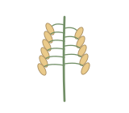](icons/biology/plant-morphology/rice-panicle.svg) |  | [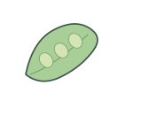](icons/biology/plant-morphology/soybean-pod.svg) |

| Tomato fruit / 番茄果实 | Wheat spike / 小麦穗 |  |  |
| --- | --- | --- | --- |
| [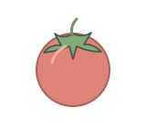](icons/biology/plant-morphology/tomato-fruit.svg) |  |  |  |

## Plant phenotyping | 植物表型实验

Editable conceptual illustrations; biological details and experimental interpretation should be checked for the specific species or assay. 可编辑示意素材；具体结构和实验含义应结合物种及实验核对。

| Foliar spraying / 叶面喷施 | Seed germination dish / 培养皿种子萌发 | Hydroponic plant / 水培植株 | Leaf chlorophyll meter / 叶片叶绿素仪 |
| --- | --- | --- | --- |
| [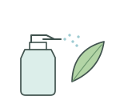](icons/experiments/plant-phenotyping/foliar-spray.svg) | [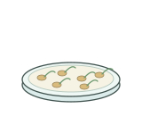](icons/experiments/plant-phenotyping/germination-dish.svg) | [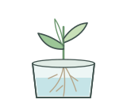](icons/experiments/plant-phenotyping/hydroponic-plant.svg) | [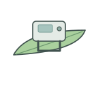](icons/experiments/plant-phenotyping/leaf-chlorophyll-meter.svg) |

| Leaf disc punch / 叶片打孔器 | Leaf gas-exchange chamber / 叶片气体交换叶室 | Plant label / 植物标牌 | Plant sample bag / 植物样品袋 |
| --- | --- | --- | --- |
|  |  |  |  |

| Plant in pot / 盆栽植株 | Root imaging tray / 根系成像托盘 | Root rinsing / 根系冲洗 | Seedling tray / 育苗盘 |
| --- | --- | --- | --- |
|  |  |  |  |

## Molecular components | 分子机制组件

Editable conceptual illustrations; biological details and experimental interpretation should be checked for the specific species or assay. 可编辑示意素材；具体结构和实验含义应结合物种及实验核对。

| Affinity chromatography column / 亲和层析柱 | Antibody and antigen binding / 抗体与抗原结合 | Antibody-coated bead / 抗体偶联微珠 | Double-stranded RNA / 双链 RNA |
| --- | --- | --- | --- |
|  |  |  |  |

| Enzyme and substrate binding / 酶与底物结合 | IgG antibody / IgG 抗体 | Magnetic bead / 磁珠 | Messenger RNA / 信使 RNA |
| --- | --- | --- | --- |
|  |  |  |  |

| Nucleosome / 核小体 | Nucleosome array / 核小体阵列 | Circular plasmid vector / 环状质粒载体 | Polyubiquitin chain / 多聚泛素链 |
| --- | --- | --- | --- |
|  |  |  |  |

| Protein dimer / 蛋白质二聚体 | Protein domain architecture / 蛋白结构域示意 | Protein trimer / 蛋白质三聚体 | RNA hairpin / RNA 发夹结构 |
| --- | --- | --- | --- |
|  |  |  |  |

| RNA polymerase on DNA / DNA 上的 RNA 聚合酶 | Small interfering RNA duplex / 小干扰 RNA 双链 | Transfer RNA / 转运 RNA | Ubiquitin tagged protein / 泛素化蛋白 |
| --- | --- | --- | --- |
|  |  |  |  |

## Reporter assays | 报告基因实验

Editable conceptual examples; staining patterns, construct organization, and experimental interpretation depend on the actual experiment. 可编辑示意素材；染色模式、载体结构及实验解释应依据具体实验调整。

| Bacterial suspension tube / 细菌悬液管 | EMSA gel mobility shift / EMSA 凝胶迁移率变化 | GUS stained leaf / GUS 染色叶片 | GUS stained root / GUS 染色根系 |
| --- | --- | --- | --- |
|  |  |  |  |

| GUS stained tissue section / GUS 染色组织切片 | Histochemical staining vial / 组织化学染色瓶 | Leaf syringe infiltration / 叶片注射渗透 | Luciferase reporter leaf / 荧光素酶报告叶片 |
| --- | --- | --- | --- |
|  |  |  |  |

| Promoter GUS reporter construct / 启动子 GUS 报告载体元件 | Promoter LUC reporter construct / 启动子 LUC 报告载体元件 | qPCR fluorescence tubes / qPCR 荧光反应管 | Western blot strip / 蛋白免疫印迹条带 |
| --- | --- | --- | --- |
|  |  |  |  |

## Plant tissue culture | 植物组织培养

Editable conceptual components for plant tissue culture. Callus, shoot regeneration and rooting are schematic and do not establish transformation or experimental success. 可编辑植物组织培养示意素材；愈伤组织、芽再生和生根的图示不代表转化成功或实验结果。

| Callus culture vessel / 愈伤组织培养瓶 | Callus on medium / 培养基上的愈伤组织 | Plant tissue culture vessel / 植物组织培养瓶 | Explant on medium / 培养基上的外植体 |
| --- | --- | --- | --- |
|  |  |  |  |

| Explant transfer with forceps / 镊子转移外植体 | Liquid culture medium flask / 液体培养基锥形瓶 | Maize immature embryo explant / 玉米幼胚外植体 | Plantlet acclimatization / 组培苗移栽驯化 |
| --- | --- | --- | --- |
|  |  |  |  |

| Rooted plantlet in culture / 生根培养苗 | Seed surface sterilization / 种子表面消毒 | Shoot regeneration / 芽再生 | Stem segment explant / 茎段外植体 |
| --- | --- | --- | --- |
|  |  |  |  |

## Microscopy components | 显微成像与制片

Editable conceptual microscopy and specimen preparation illustrations. Calibrate scale bars against actual images; instrument details depend on the model. 可编辑的显微成像及制片示意图；比例尺应根据实际图像校准，仪器细节因型号而异。

| Microscope coverslip / 显微镜盖玻片 | Fluorescence channel merge / 荧光通道合并 | Fluorescence filter cube / 荧光滤光片组 | Microscope digital camera / 显微镜相机 |
| --- | --- | --- | --- |
|  |  |  |  |

| Microscope objective lens / 显微镜物镜 | Microscopy scale bar / 显微图比例尺 | Laboratory microtome / 切片机 | Mounting medium drop / 封片剂液滴 |
| --- | --- | --- | --- |
|  |  |  |  |

| Paraffin embedded tissue block / 石蜡包埋组织块 | Tissue embedding cassette / 组织包埋盒 | Microscopy z stack / 显微 Z 轴序列 |  |
| --- | --- | --- | --- |
|  |  |  |  |

## Plant physiology | 植物生理实验

Editable experimental illustrations; treatment concentration, measurement definitions and results must follow the actual experiment. 可编辑的实验示意图；处理浓度、测量定义和结果应依据实际实验确定。

| Leaf pigment extraction tube / 叶片色素提取管 | Electrolyte leakage sample / 电解质渗漏测定样品 | Fresh biomass weighing / 鲜重称量 | Ion analysis sample tubes / 离子含量测定样品管 |
| --- | --- | --- | --- |
|  |  |  |  |

| Leaf water-content sample / 叶片含水量样品 | Root length measurement / 根长测量 | Root and shoot separation / 根与地上部取样 | Salt treatment hydroponic vessel / 盐处理水培容器 |
| --- | --- | --- | --- |
|  |  |  |  |

| Salt treatment germination dish / 盐处理萌发培养皿 | Salt solution flask / 盐溶液配制 | Shoot height measurement / 地上部高度测量 | Stained root sample / 根系染色样品 |
| --- | --- | --- | --- |
|  |  |  |  |

