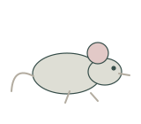

# Animal research | 动物研究

[All categories / 全部分类](../README.md) · [Repository / 仓库主页](../../README.md)

Mouse models, housing, identification and phenotyping. 小鼠、饲养设施、标记与表型研究。

**12 SVGs · 1 subcategories / 12 个 SVG · 1 个子分类**

| Subcategory / 子分类 | SVGs / 数量 | Example / 示例 |
| --- | ---: | --- |
| [Mouse research / 小鼠研究](mouse-research/README.md) | 12 |  |

Each subcategory README includes all previews and SVG links. 每个子分类 README 提供完整预览及 SVG 链接。
