# Mouse research | 小鼠研究

[All categories / 全部分类](../../README.md) · [Animal research / 动物研究](../README.md) · [Repository / 仓库主页](../../../README.md)

**12 editable SVGs / 12 个可编辑 SVG**

Browse mouse research illustrations below. Click an image to open its editable SVG. 本目录收录小鼠研究素材，点击预览可打开 SVG 源文件。

| Laboratory mouse dorsal view / 实验小鼠背面 | Laboratory mouse profile / 实验小鼠侧面 | Mouse body weight measurement / 小鼠体重称量 | Mouse drinking bottle / 小鼠饮水瓶 |
| --- | --- | --- | --- |
| [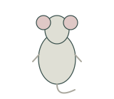](laboratory-mouse-dorsal.svg) | [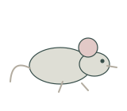](laboratory-mouse-profile.svg) | [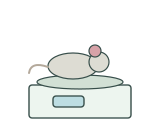](mouse-body-weight.svg) | [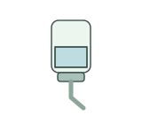](mouse-water-bottle.svg) |

| Mouse ear tag / 小鼠耳标 | Mouse enrichment tunnel / 小鼠丰容隧道 | Mouse feed hopper / 小鼠饲料槽 | Mouse footprints / 小鼠足迹 |
| --- | --- | --- | --- |
| [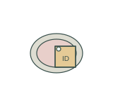](mouse-ear-tag.svg) | [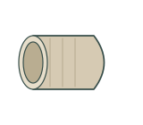](mouse-enrichment-tunnel.svg) |  | [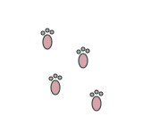](mouse-footprints.svg) |

| Mouse housing cage / 小鼠饲养笼 | Mouse open field arena / 小鼠旷场装置 | Mouse restraint tube / 小鼠固定管 | Mouse running wheel / 小鼠跑轮 |
| --- | --- | --- | --- |
| [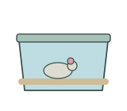](mouse-housing-cage.svg) | [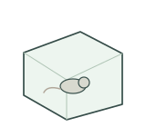](mouse-open-field-arena.svg) | [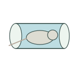](mouse-restraint-tube.svg) | [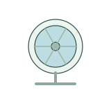](mouse-running-wheel.svg) |

## Use and metadata | 使用与元数据

These assets are conceptual schematics. Adapt anatomy, labels, relationships and example data to the study. 此处素材为概念示意图，使用时应结合研究核对结构、标注、关系及示例数据。

See the [icon index](../../../metadata/icon-index.csv) for source, creator, license and review status. 来源、创作者、授权与审核状态见图标索引。Assets marked `not-assigned` have no assigned reuse license. 标记为 `not-assigned` 的素材尚未确定再利用授权。
