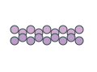
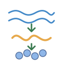
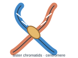
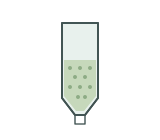
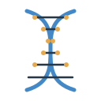
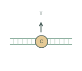
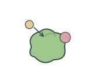
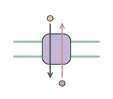

# Cellular and molecular biology | 细胞与分子生物学

[All categories / 全部分类](../README.md) · [Repository / 仓库主页](../../README.md)

Cells, organelles, nucleic acids, proteins and biological mechanisms. 细胞、细胞器、核酸、蛋白质及生物学机制。

**141 SVGs · 12 subcategories / 141 个 SVG · 12 个子分类**

| Subcategory / 子分类 | SVGs / 数量 | Example / 示例 |
| --- | ---: | --- |
| [Cell processes / 细胞过程](cell-processes/README.md) | 12 |  |
| [Cells / 细胞](cells/README.md) | 2 |  |
| [Cellular components / 细胞与亚细胞组分](cellular-components/README.md) | 20 |  |
| [Gene diagram elements / 基因图示组件](gene-elements/README.md) | 19 |  |
| [Gene expression / 基因表达](gene-expression/README.md) | 4 |  |
| [Genetics / 遗传学](genetics/README.md) | 5 |  |
| [Molecular components / 分子组件](molecular-components/README.md) | 20 |  |
| [Molecules / 生物分子](molecules/README.md) | 3 |  |
| [Nucleic acid operations / 核酸操作](nucleic-acid-operations/README.md) | 12 |  |
| [Protein mechanisms / 蛋白分子机制](protein-mechanisms/README.md) | 12 |  |
| [Stress and signaling / 逆境与信号](stress-signaling/README.md) | 20 |  |
| [Transport mechanisms / 物质运输](transport-mechanisms/README.md) | 12 |  |

Each subcategory README includes all previews and SVG links. 每个子分类 README 提供完整预览及 SVG 链接。
