# Cell processes | 细胞过程

[All categories / 全部分类](../../README.md) · [Cellular and molecular biology / 细胞与分子生物学](../README.md) · [Repository / 仓库主页](../../../README.md)

**12 editable SVGs / 12 个可编辑 SVG**

Browse cell processes illustrations below. Click an image to open its editable SVG. 本目录收录细胞过程素材，点击预览可打开 SVG 源文件。

| Autophagic sequestration / 自噬包裹 | Cell division plane / 细胞分裂平面 | Cell turgor / 细胞膨压 | Cytoplasmic streaming / 细胞质流动 |
| --- | --- | --- | --- |
|  | [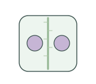](cell-division-plane.svg) | [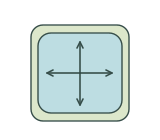](cell-turgor.svg) | [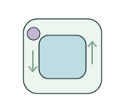](cytoplasmic-streaming.svg) |

| Endocytosis / 内吞作用 | Exocytosis / 胞吐作用 | Nuclear export / 核输出 | Nuclear import / 核输入 |
| --- | --- | --- | --- |
| [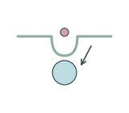](endocytosis.svg) | [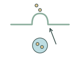](exocytosis.svg) | [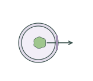](nuclear-export.svg) | [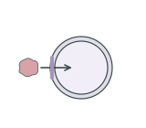](nuclear-import.svg) |

| Organelle contact site / 细胞器接触位点 | Plasmolysis / 质壁分离 | Vacuolar sequestration / 液泡区隔化 | Vesicle fusion / 囊泡融合 |
| --- | --- | --- | --- |
| [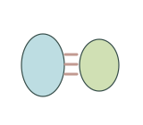](organelle-contact-site.svg) | [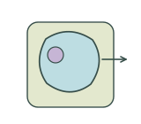](plasmolysis.svg) | [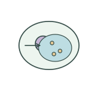](vacuolar-sequestration.svg) | [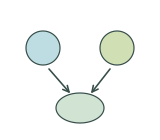](vesicle-fusion.svg) |

## Use and metadata | 使用与元数据

These assets are conceptual schematics. Adapt anatomy, labels, relationships and example data to the study. 此处素材为概念示意图，使用时应结合研究核对结构、标注、关系及示例数据。

See the [icon index](../../../metadata/icon-index.csv) for source, creator, license and review status. 来源、创作者、授权与审核状态见图标索引。Assets marked `not-assigned` have no assigned reuse license. 标记为 `not-assigned` 的素材尚未确定再利用授权。
