# Cellular components | 细胞与亚细胞组分

[All categories / 全部分类](../../README.md) · [Cellular and molecular biology / 细胞与分子生物学](../README.md) · [Repository / 仓库主页](../../../README.md)

**20 editable SVGs / 20 个可编辑 SVG**

Browse cellular components illustrations below. Click an image to open its editable SVG. 本目录收录细胞与亚细胞组分素材，点击预览可打开 SVG 源文件。

| Actin filament / 肌动蛋白丝 | Central vacuole / 中央液泡 | Golgi apparatus / 高尔基体 | Lipid droplet / 脂滴 |
| --- | --- | --- | --- |
| [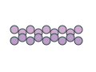](actin-filament.svg) |  |  |  |

| Microtubule / 微管 | Mitochondrion / 线粒体 | Nuclear pore complex / 核孔复合体 | Nucleolus / 核仁 |
| --- | --- | --- | --- |
| [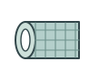](microtubule.svg) | [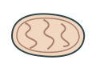](mitochondrion.svg) | [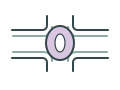](nuclear-pore.svg) |  |

| Nucleus / 细胞核 | Peroxisome / 过氧化物酶体 | Plant cell wall / 植物细胞壁 | Plasma membrane / 质膜 |
| --- | --- | --- | --- |
| [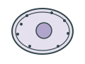](nucleus.svg) | [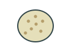](peroxisome.svg) | [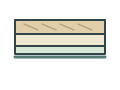](plant-cell-wall.svg) | [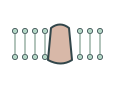](plasma-membrane.svg) |

| Plasmodesma / 胞间连丝 | Proteasome / 蛋白酶体 | Ribosome / 核糖体 | Rough endoplasmic reticulum / 粗面内质网 |
| --- | --- | --- | --- |
| [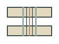](plasmodesma.svg) | [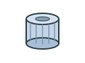](proteasome.svg) | [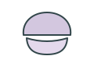](ribosome.svg) | [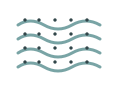](rough-endoplasmic-reticulum.svg) |

| Smooth endoplasmic reticulum / 光面内质网 | Starch granule / 淀粉粒 | Tonoplast / 液泡膜 | Transport vesicle / 运输囊泡 |
| --- | --- | --- | --- |
|  | [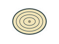](starch-granule.svg) | [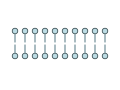](tonoplast.svg) | [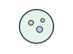](transport-vesicle.svg) |

## Use and metadata | 使用与元数据

These assets are conceptual schematics. Adapt anatomy, labels, relationships and example data to the study. 此处素材为概念示意图，使用时应结合研究核对结构、标注、关系及示例数据。

See the [icon index](../../../metadata/icon-index.csv) for source, creator, license and review status. 来源、创作者、授权与审核状态见图标索引。Assets marked `not-assigned` have no assigned reuse license. 标记为 `not-assigned` 的素材尚未确定再利用授权。
