# Gene diagram elements | 基因图示组件

[All categories / 全部分类](../../README.md) · [Cellular and molecular biology / 细胞与分子生物学](../README.md) · [Repository / 仓库主页](../../../README.md)

**19 editable SVGs / 19 个可编辑 SVG**

Browse gene diagram elements illustrations below. Click an image to open its editable SVG. 本目录收录基因图示组件素材，点击预览可打开 SVG 源文件。

| 3′ untranslated region / 3′ 非翻译区 | 5′ untranslated region / 5′ 非翻译区 | Cis-regulatory motif / 顺式调控元件 | Coding sequence / 编码序列 |
| --- | --- | --- | --- |
| [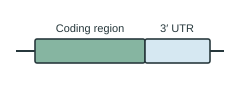](three-prime-utr.svg) | [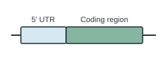](five-prime-utr.svg) |  | [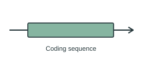](coding-sequence.svg) |

| Enhancer / 增强子 | Exon / 外显子 | Intron / 内含子 | Polyadenylation site / 多聚腺苷酸化位点 |
| --- | --- | --- | --- |
| [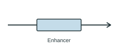](enhancer.svg) | [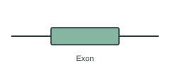](exon.svg) | [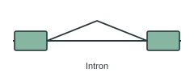](intron.svg) | [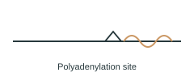](polyadenylation-site.svg) |

| Promoter / 启动子 | Sequence deletion / 序列缺失 | Sequence insertion / 序列插入 | Silencer / 沉默子 |
| --- | --- | --- | --- |
| [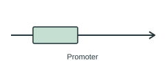](promoter.svg) | [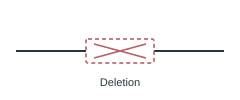](sequence-deletion.svg) |  | [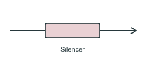](silencer.svg) |

| Single-nucleotide substitution / 单核苷酸替换 | Splice acceptor site / 剪接受体位点 | Splice donor site / 剪接供体位点 | Tandem repeat / 串联重复 |
| --- | --- | --- | --- |
| [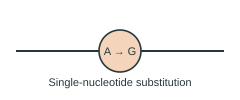](single-nucleotide-substitution.svg) | [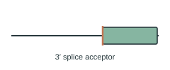](splice-acceptor-site.svg) | [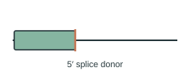](splice-donor-site.svg) | [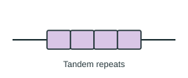](tandem-repeat.svg) |

| Transcription factor binding / 转录因子结合 | Transcription start site / 转录起始位点 | Transcription terminator / 转录终止子 |  |
| --- | --- | --- | --- |
|  | [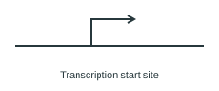](transcription-start-site.svg) | [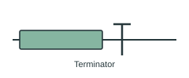](terminator.svg) |  |

## Use and metadata | 使用与元数据

These assets are conceptual schematics. Adapt anatomy, labels, relationships and example data to the study. 此处素材为概念示意图，使用时应结合研究核对结构、标注、关系及示例数据。

See the [icon index](../../../metadata/icon-index.csv) for source, creator, license and review status. 来源、创作者、授权与审核状态见图标索引。Assets marked `not-assigned` have no assigned reuse license. 标记为 `not-assigned` 的素材尚未确定再利用授权。
