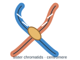
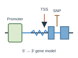
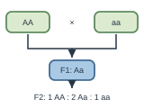
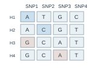
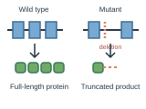

# Genetics | 遗传学

[All categories / 全部分类](../../README.md) · [Cellular and molecular biology / 细胞与分子生物学](../README.md) · [Repository / 仓库主页](../../../README.md)

**5 editable SVGs / 5 个可编辑 SVG**

Browse genetics illustrations below. Click an image to open its editable SVG. 本目录收录遗传学素材，点击预览可打开 SVG 源文件。

| Chromosome / 染色体 | Gene locus / 基因位点 | Genetic cross / 遗传杂交 | Haplotype block / 单倍型区块 |
| --- | --- | --- | --- |
|  |  |  |  |

| Loss-of-function mutant / 功能缺失突变体 |  |  |  |
| --- | --- | --- | --- |
|  |  |  |  |

## Use and metadata | 使用与元数据

These assets are conceptual schematics. Adapt anatomy, labels, relationships and example data to the study. 此处素材为概念示意图，使用时应结合研究核对结构、标注、关系及示例数据。

See the [icon index](../../../metadata/icon-index.csv) for source, creator, license and review status. 来源、创作者、授权与审核状态见图标索引。Assets marked `not-assigned` have no assigned reuse license. 标记为 `not-assigned` 的素材尚未确定再利用授权。
