# Molecular components | 分子组件

[All categories / 全部分类](../../README.md) · [Cellular and molecular biology / 细胞与分子生物学](../README.md) · [Repository / 仓库主页](../../../README.md)

**20 editable SVGs / 20 个可编辑 SVG**

Browse molecular components illustrations below. Click an image to open its editable SVG. 本目录收录分子组件素材，点击预览可打开 SVG 源文件。

| Affinity chromatography column / 亲和层析柱 | Antibody and antigen binding / 抗体与抗原结合 | Antibody-coated bead / 抗体偶联微珠 | Circular plasmid vector / 环状质粒载体 |
| --- | --- | --- | --- |
| [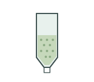](affinity-column.svg) | [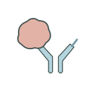](antibody-antigen-binding.svg) | [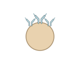](antibody-coated-bead.svg) |  |

| Double-stranded RNA / 双链 RNA | Enzyme and substrate binding / 酶与底物结合 | IgG antibody / IgG 抗体 | Magnetic bead / 磁珠 |
| --- | --- | --- | --- |
| [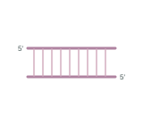](double-stranded-rna.svg) | [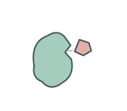](enzyme-substrate-binding.svg) | [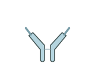](igg-antibody.svg) | [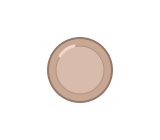](magnetic-bead.svg) |

| Messenger RNA / 信使 RNA | Nucleosome / 核小体 | Nucleosome array / 核小体阵列 | Polyubiquitin chain / 多聚泛素链 |
| --- | --- | --- | --- |
| [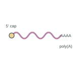](messenger-rna.svg) | [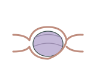](nucleosome.svg) | [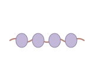](nucleosome-array.svg) | [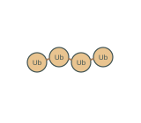](polyubiquitin-chain.svg) |

| Protein dimer / 蛋白质二聚体 | Protein domain architecture / 蛋白结构域示意 | Protein trimer / 蛋白质三聚体 | RNA hairpin / RNA 发夹结构 |
| --- | --- | --- | --- |
| [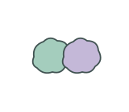](protein-dimer.svg) | [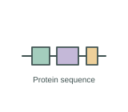](protein-domain-architecture.svg) | [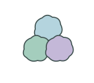](protein-trimer.svg) |  |

| RNA polymerase on DNA / DNA 上的 RNA 聚合酶 | Small interfering RNA duplex / 小干扰 RNA 双链 | Transfer RNA / 转运 RNA | Ubiquitin tagged protein / 泛素化蛋白 |
| --- | --- | --- | --- |
| [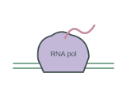](rna-polymerase-dna.svg) | [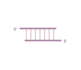](small-interfering-rna.svg) |  | [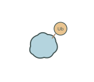](ubiquitin-protein-tag.svg) |

## Use and metadata | 使用与元数据

These assets are conceptual schematics. Adapt anatomy, labels, relationships and example data to the study. 此处素材为概念示意图，使用时应结合研究核对结构、标注、关系及示例数据。

See the [icon index](../../../metadata/icon-index.csv) for source, creator, license and review status. 来源、创作者、授权与审核状态见图标索引。Assets marked `not-assigned` have no assigned reuse license. 标记为 `not-assigned` 的素材尚未确定再利用授权。
