# Nucleic acid operations | 核酸操作

[All categories / 全部分类](../../README.md) · [Cellular and molecular biology / 细胞与分子生物学](../README.md) · [Repository / 仓库主页](../../../README.md)

**12 editable SVGs / 12 个可编辑 SVG**

Browse nucleic acid operations illustrations below. Click an image to open its editable SVG. 本目录收录核酸操作素材，点击预览可打开 SVG 源文件。

| Base editing concept / 碱基编辑示意 | DNA band excision / DNA 条带切胶 | DNA double strand break / DNA 双链断裂 | DNA end joining / DNA 末端连接 |
| --- | --- | --- | --- |
| [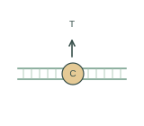](base-editing-concept.svg) |  | [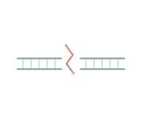](dna-double-strand-break.svg) | [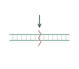](dna-end-joining.svg) |

| DNA ligation / DNA 连接 | DNA methylation / DNA 甲基化 | DNA pull down / DNA pull-down | Fluorescent DNA probe / 荧光 DNA 探针 |
| --- | --- | --- | --- |
| [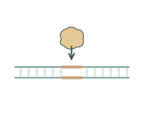](dna-ligation.svg) | [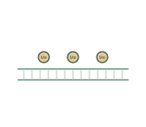](dna-methylation.svg) | [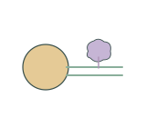](dna-pulldown.svg) | [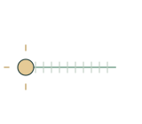](fluorescent-dna-probe.svg) |

| Homology directed repair / 同源定向修复 | PCR primer pair / PCR 引物对 | Restriction digest / 限制性内切酶酶切 | RNA interference concept / RNA 干扰示意 |
| --- | --- | --- | --- |
| [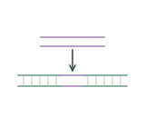](homology-directed-repair.svg) | [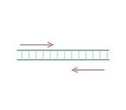](pcr-primer-pair.svg) | [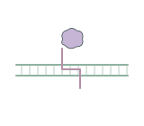](restriction-digest.svg) | [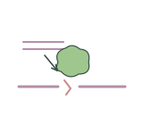](rna-interference-concept.svg) |

## Use and metadata | 使用与元数据

These assets are conceptual schematics. Adapt anatomy, labels, relationships and example data to the study. 此处素材为概念示意图，使用时应结合研究核对结构、标注、关系及示例数据。

See the [icon index](../../../metadata/icon-index.csv) for source, creator, license and review status. 来源、创作者、授权与审核状态见图标索引。Assets marked `not-assigned` have no assigned reuse license. 标记为 `not-assigned` 的素材尚未确定再利用授权。
