# Protein mechanisms | 蛋白分子机制

[All categories / 全部分类](../../README.md) · [Cellular and molecular biology / 细胞与分子生物学](../README.md) · [Repository / 仓库主页](../../../README.md)

**12 editable SVGs / 12 个可编辑 SVG**

Browse protein mechanisms illustrations below. Click an image to open its editable SVG. 本目录收录蛋白分子机制素材，点击预览可打开 SVG 源文件。

| Allosteric regulation / 变构调节 | Biomolecular condensate / 生物分子凝聚体 | Cofactor binding / 辅因子结合 | Competitive inhibition / 竞争性抑制 |
| --- | --- | --- | --- |
| [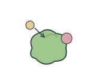](allosteric-regulation.svg) | [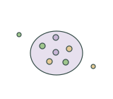](biomolecular-condensate.svg) | [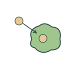](cofactor-binding.svg) | [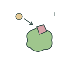](competitive-inhibition.svg) |

| Disulfide bond / 二硫键 | Enzyme turnover / 酶催化周转 | Protein aggregation / 蛋白聚集 | Protein complex dissociation / 蛋白复合体解离 |
| --- | --- | --- | --- |
| [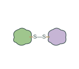](disulfide-bond.svg) | [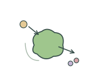](enzyme-turnover.svg) | [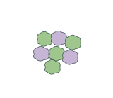](protein-aggregation.svg) | [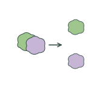](protein-complex-dissociation.svg) |

| Protein glycosylation / 蛋白糖基化 | Protein unfolding / 蛋白展开 | Proteolytic activation / 蛋白水解激活 | Scaffold mediated assembly / 支架蛋白介导组装 |
| --- | --- | --- | --- |
| [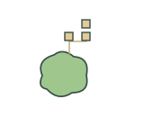](protein-glycosylation.svg) | [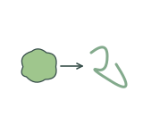](protein-unfolding.svg) | [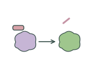](proteolytic-activation.svg) |  |

## Use and metadata | 使用与元数据

These assets are conceptual schematics. Adapt anatomy, labels, relationships and example data to the study. 此处素材为概念示意图，使用时应结合研究核对结构、标注、关系及示例数据。

See the [icon index](../../../metadata/icon-index.csv) for source, creator, license and review status. 来源、创作者、授权与审核状态见图标索引。Assets marked `not-assigned` have no assigned reuse license. 标记为 `not-assigned` 的素材尚未确定再利用授权。
