# Stress and signaling | 逆境与信号

[All categories / 全部分类](../../README.md) · [Cellular and molecular biology / 细胞与分子生物学](../README.md) · [Repository / 仓库主页](../../../README.md)

**20 editable SVGs / 20 个可编辑 SVG**

Browse stress and signaling illustrations below. Click an image to open its editable SVG. 本目录收录逆境与信号素材，点击预览可打开 SVG 源文件。

| Antioxidant defense / 抗氧化防御 | Bacterial cell / 细菌细胞 | Cold stress / 低温胁迫 | Drought stress / 干旱胁迫 |
| --- | --- | --- | --- |
|  |  |  | [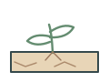](drought-stress.svg) |

| Dry soil / 干旱土壤 | Fungal hypha / 真菌菌丝 | Heat stress / 高温胁迫 | High light / 强光 |
| --- | --- | --- | --- |
| [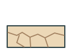](dry-soil.svg) |  | [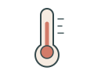](heat-stress.svg) |  |

| Hypoxia / 低氧胁迫 | Mechanical wounding / 机械损伤 | Membrane ion channel / 膜离子通道 | Membrane receptor / 膜受体 |
| --- | --- | --- | --- |
| [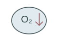](hypoxia.svg) |  | [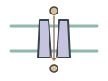](ion-channel.svg) |  |

| Osmotic stress / 渗透胁迫 | Protein phosphorylation / 蛋白磷酸化 | Reactive oxygen species / 活性氧 | Saline soil / 盐胁迫土壤 |
| --- | --- | --- | --- |
| [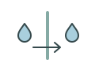](osmotic-stress.svg) | [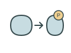](protein-phosphorylation.svg) |  | [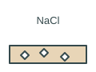](soil-salinity.svg) |

| Transcriptional response / 转录响应 | UV exposure / 紫外线胁迫 | Virus particle / 病毒颗粒 | Waterlogged soil / 渍水土壤 |
| --- | --- | --- | --- |
| [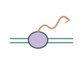](transcriptional-response.svg) | [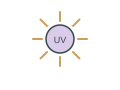](uv-exposure.svg) |  | [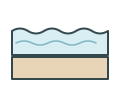](flooded-soil.svg) |

## Use and metadata | 使用与元数据

These assets are conceptual schematics. Adapt anatomy, labels, relationships and example data to the study. 此处素材为概念示意图，使用时应结合研究核对结构、标注、关系及示例数据。

See the [icon index](../../../metadata/icon-index.csv) for source, creator, license and review status. 来源、创作者、授权与审核状态见图标索引。Assets marked `not-assigned` have no assigned reuse license. 标记为 `not-assigned` 的素材尚未确定再利用授权。
