# Transport mechanisms | 物质运输

[All categories / 全部分类](../../README.md) · [Cellular and molecular biology / 细胞与分子生物学](../README.md) · [Repository / 仓库主页](../../../README.md)

**12 editable SVGs / 12 个可编辑 SVG**

Browse transport mechanisms illustrations below. Click an image to open its editable SVG. 本目录收录物质运输素材，点击预览可打开 SVG 源文件。

| Antiport / 反向交换运输 | Apoplastic transport pathway / 质外体运输途径 | Aquaporin mediated water transport / 水通道蛋白介导水运输 | Facilitated diffusion / 易化扩散 |
| --- | --- | --- | --- |
| [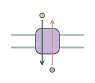](antiport.svg) | [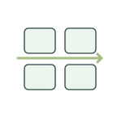](apoplastic-pathway.svg) | [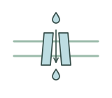](aquaporin-concept.svg) | [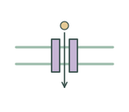](facilitated-diffusion.svg) |

| Phloem loading / 韧皮部装载 | Primary active transport / 初级主动运输 | Proton gradient / 质子梯度 | Simple diffusion / 简单扩散 |
| --- | --- | --- | --- |
| [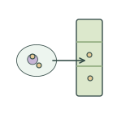](phloem-loading.svg) | [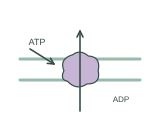](primary-active-transport.svg) | [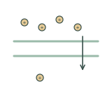](proton-gradient.svg) | [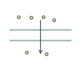](simple-diffusion.svg) |

| Stomatal gas diffusion / 气孔气体扩散 | Symplastic transport pathway / 共质体运输途径 | Symport / 同向协同运输 | Xylem bulk flow / 木质部集流 |
| --- | --- | --- | --- |
| [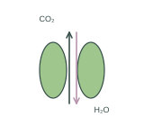](stomatal-gas-diffusion.svg) | [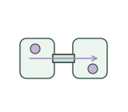](symplastic-pathway.svg) | [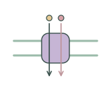](symport.svg) | [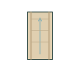](xylem-bulk-flow.svg) |

## Use and metadata | 使用与元数据

These assets are conceptual schematics. Adapt anatomy, labels, relationships and example data to the study. 此处素材为概念示意图，使用时应结合研究核对结构、标注、关系及示例数据。

See the [icon index](../../../metadata/icon-index.csv) for source, creator, license and review status. 来源、创作者、授权与审核状态见图标索引。Assets marked `not-assigned` have no assigned reuse license. 标记为 `not-assigned` 的素材尚未确定再利用授权。
