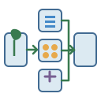

# Diagram elements and workflows | 图示元素与流程

[All categories / 全部分类](../README.md) · [Repository / 仓库主页](../../README.md)

Reusable pathway symbols and workflow illustrations. 可组合的通路符号与流程示意。

**6 SVGs · 2 subcategories / 6 个 SVG · 2 个子分类**

| Subcategory / 子分类 | SVGs / 数量 | Example / 示例 |
| --- | ---: | --- |
| [Pathway symbols / 通路符号](pathways/README.md) | 2 |  |
| [Workflows / 流程示意](workflows/README.md) | 4 |  |

Each subcategory README includes all previews and SVG links. 每个子分类 README 提供完整预览及 SVG 链接。
