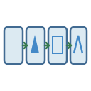
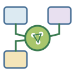
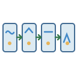
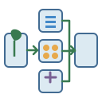

# Workflows | 流程示意

[All categories / 全部分类](../../README.md) · [Diagram elements and workflows / 图示元素与流程](../README.md) · [Repository / 仓库主页](../../../README.md)

**4 editable SVGs / 4 个可编辑 SVG**

Browse workflows illustrations below. Click an image to open its editable SVG. 本目录收录流程示意素材，点击预览可打开 SVG 源文件。

| Bioinformatics pipeline / 生物信息学分析流程 | Multi-omics integration / 多组学整合 | RNA-seq workflow / RNA 测序流程 | Sample-to-omics workflow / 样品至组学分析流程 |
| --- | --- | --- | --- |
|  |  |  |  |

## Use and metadata | 使用与元数据

These assets are conceptual schematics. Adapt anatomy, labels, relationships and example data to the study. 此处素材为概念示意图，使用时应结合研究核对结构、标注、关系及示例数据。

See the [icon index](../../../metadata/icon-index.csv) for source, creator, license and review status. 来源、创作者、授权与审核状态见图标索引。Assets marked `not-assigned` have no assigned reuse license. 标记为 `not-assigned` 的素材尚未确定再利用授权。
