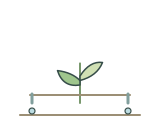
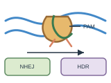
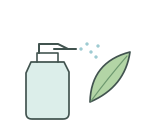
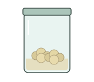
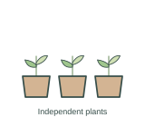

# Experimental methods and equipment | 实验方法与设备

[All categories / 全部分类](../README.md) · [Repository / 仓库主页](../../README.md)

Laboratory equipment, sample preparation and plant experiments. 实验设备、样品制备和植物实验。

**131 SVGs · 9 subcategories / 131 个 SVG · 9 个子分类**

| Subcategory / 子分类 | SVGs / 数量 | Example / 示例 |
| --- | ---: | --- |
| [Field research / 田间试验](field-research/README.md) | 12 |  |
| [Laboratory equipment / 实验设备](lab-equipment/README.md) | 20 |  |
| [Laboratory supplies / 实验耗材](lab-supplies/README.md) | 21 |  |
| [Microscopy and specimen sectioning / 显微成像与制片](microscopy/README.md) | 12 |  |
| [Molecular and reporter assays / 分子与报告基因实验](molecular-assays/README.md) | 18 |  |
| [Plant phenotyping / 植物表型测量](plant-phenotyping/README.md) | 12 |  |
| [Plant physiology / 植物生理实验](plant-physiology/README.md) | 12 |  |
| [Plant tissue culture / 植物组织培养](plant-tissue-culture/README.md) | 12 |  |
| [Specimen preparation / 样品制备](specimen-preparation/README.md) | 12 |  |

Each subcategory README includes all previews and SVG links. 每个子分类 README 提供完整预览及 SVG 链接。
