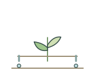
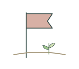
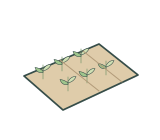
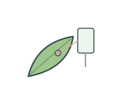
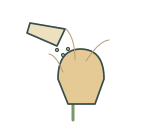
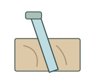
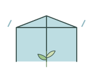
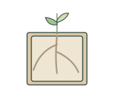
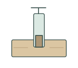
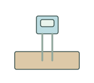

# Field research | 田间试验

[All categories / 全部分类](../../README.md) · [Experimental methods and equipment / 实验方法与设备](../README.md) · [Repository / 仓库主页](../../../README.md)

**12 editable SVGs / 12 个可编辑 SVG**

Browse field research illustrations below. Click an image to open its editable SVG. 本目录收录田间试验素材，点击预览可打开 SVG 源文件。

| Drip irrigation / 滴灌 | Field sample flag / 田间取样标旗 | Field trial plots / 田间试验小区 | Harvested shoot bundle / 收获植株束 |
| --- | --- | --- | --- |
|  |  |  |  |

| Leaf temperature sensor / 叶温测量 | Manual pollination / 人工授粉 | Minirhizotron tube / 微根管 | Pollination bag / 授粉袋 |
| --- | --- | --- | --- |
|  |  |  |  |

| Rainout shelter / 避雨棚 | Root observation box / 根系观察箱 | Soil core sampling / 土芯取样 | Soil moisture probe / 土壤水分探头 |
| --- | --- | --- | --- |
|  |  |  |  |

## Use and metadata | 使用与元数据

These assets are conceptual schematics. Adapt anatomy, labels, relationships and example data to the study. 此处素材为概念示意图，使用时应结合研究核对结构、标注、关系及示例数据。

See the [icon index](../../../metadata/icon-index.csv) for source, creator, license and review status. 来源、创作者、授权与审核状态见图标索引。Assets marked `not-assigned` have no assigned reuse license. 标记为 `not-assigned` 的素材尚未确定再利用授权。
