# Laboratory equipment | 实验设备

[All categories / 全部分类](../../README.md) · [Experimental methods and equipment / 实验方法与设备](../README.md) · [Repository / 仓库主页](../../../README.md)

**20 editable SVGs / 20 个可编辑 SVG**

Browse laboratory equipment illustrations below. Click an image to open its editable SVG. 本目录收录实验设备素材，点击预览可打开 SVG 源文件。

| Analytical balance / 分析天平 | Conductivity meter / 电导率仪 | Dry block heater / 干式恒温器 | Erlenmeyer flask / 锥形瓶 |
| --- | --- | --- | --- |
| [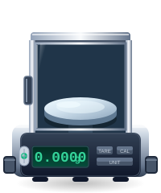](analytical-balance.svg) | [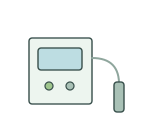](conductivity-meter.svg) | [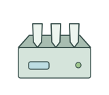](dry-block-heater.svg) |  |

| Laboratory centrifuge / 实验室离心机 | Laboratory desiccator / 干燥器 | Laboratory water bath / 恒温水浴锅 | Microcentrifuge tube / 微量离心管 |
| --- | --- | --- | --- |
|  |  | [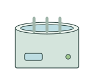](water-bath.svg) | [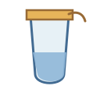](microcentrifuge-tube.svg) |

| Micropipette / 移液器 | Microplate reader / 酶标仪 | Optical cuvette / 比色皿 | Orbital shaker / 轨道摇床 |
| --- | --- | --- | --- |
|  |  | [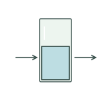](cuvette.svg) | [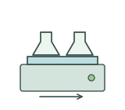](orbital-shaker.svg) |

| Peristaltic pump / 蠕动泵 | Petri dish / 培养皿 | pH meter / pH 计 | Plant growth chamber / 植物生长箱 |
| --- | --- | --- | --- |
| [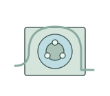](peristaltic-pump.svg) |  | [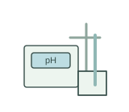](ph-meter.svg) |  |

| Spectrophotometer / 分光光度计 | Vacuum manifold / 真空抽滤装置 | Vacuum pump / 真空泵 | Vertical autoclave / 立式高压蒸汽灭菌器 |
| --- | --- | --- | --- |
|  | [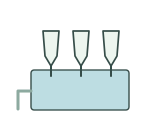](vacuum-manifold.svg) | [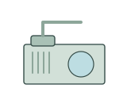](vacuum-pump.svg) | [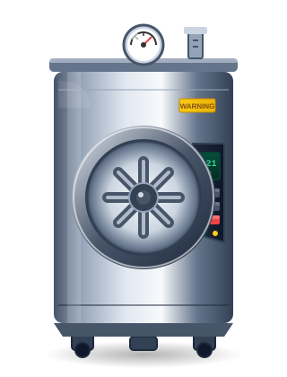](vertical-autoclave.svg) |

## Use and metadata | 使用与元数据

These assets are conceptual schematics. Adapt anatomy, labels, relationships and example data to the study. 此处素材为概念示意图，使用时应结合研究核对结构、标注、关系及示例数据。

See the [icon index](../../../metadata/icon-index.csv) for source, creator, license and review status. 来源、创作者、授权与审核状态见图标索引。Assets marked `not-assigned` have no assigned reuse license. 标记为 `not-assigned` 的素材尚未确定再利用授权。
