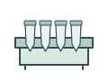
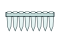

# Laboratory supplies | 实验耗材

[All categories / 全部分类](../../README.md) · [Experimental methods and equipment / 实验方法与设备](../README.md) · [Repository / 仓库主页](../../../README.md)

**21 editable SVGs / 21 个可编辑 SVG**

Browse laboratory supplies illustrations below. Click an image to open its editable SVG. 本目录收录实验耗材素材，点击预览可打开 SVG 源文件。

| Conical centrifuge tube / 锥形离心管 | Cryogenic vial / 冻存管 | Folded filter paper / 折叠滤纸 | Graduated cylinder / 量筒 |
| --- | --- | --- | --- |
|  |  |  |  |

| Laboratory beaker / 实验室烧杯 | Laboratory forceps / 实验镊子 | Laboratory funnel / 实验漏斗 | Laboratory scalpel / 手术刀 |
| --- | --- | --- | --- |
|  |  |  |  |

| Laboratory scissors / 实验剪刀 | Liquid nitrogen dewar / 液氮杜瓦瓶 | Microscope slide / 载玻片 | Microtube rack / 离心管架 |
| --- | --- | --- | --- |
|  |  |  |  |

| Mortar and pestle / 研钵和研杵 | Multiwell plate / 多孔板 | PCR tube / PCR 管 | PCR tube strip / PCR 八联管 |
| --- | --- | --- | --- |
|  |  |  |  |

| Pipette tip rack / 移液枪头盒 | Reagent bottle / 试剂瓶 | Seed envelope / 种子纸袋 | Serological pipette / 血清移液管 |
| --- | --- | --- | --- |
|  |  |  |  |

| Wash bottle / 洗瓶 |  |  |  |
| --- | --- | --- | --- |
|  |  |  |  |

## Use and metadata | 使用与元数据

These assets are conceptual schematics. Adapt anatomy, labels, relationships and example data to the study. 此处素材为概念示意图，使用时应结合研究核对结构、标注、关系及示例数据。

See the [icon index](../../../metadata/icon-index.csv) for source, creator, license and review status. 来源、创作者、授权与审核状态见图标索引。Assets marked `not-assigned` have no assigned reuse license. 标记为 `not-assigned` 的素材尚未确定再利用授权。
