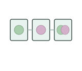
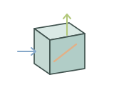
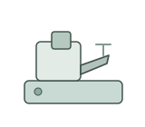
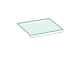
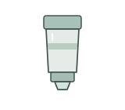
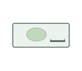
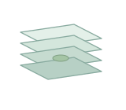
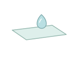
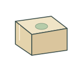

# Microscopy and specimen sectioning | 显微成像与制片

[All categories / 全部分类](../../README.md) · [Experimental methods and equipment / 实验方法与设备](../README.md) · [Repository / 仓库主页](../../../README.md)

**12 editable SVGs / 12 个可编辑 SVG**

Browse microscopy and specimen sectioning illustrations below. Click an image to open its editable SVG. 本目录收录显微成像与制片素材，点击预览可打开 SVG 源文件。

| Fluorescence channel merge / 荧光通道合并 | Fluorescence filter cube / 荧光滤光片组 | Laboratory microtome / 切片机 | Microscope / 显微镜 |
| --- | --- | --- | --- |
|  |  |  |  |

| Microscope coverslip / 显微镜盖玻片 | Microscope digital camera / 显微镜相机 | Microscope objective lens / 显微镜物镜 | Microscopy scale bar / 显微图比例尺 |
| --- | --- | --- | --- |
|  |  |  |  |

| Microscopy z stack / 显微 Z 轴序列 | Mounting medium drop / 封片剂液滴 | Paraffin embedded tissue block / 石蜡包埋组织块 | Tissue embedding cassette / 组织包埋盒 |
| --- | --- | --- | --- |
|  |  |  |  |

## Use and metadata | 使用与元数据

These assets are conceptual schematics. Adapt anatomy, labels, relationships and example data to the study. 此处素材为概念示意图，使用时应结合研究核对结构、标注、关系及示例数据。

See the [icon index](../../../metadata/icon-index.csv) for source, creator, license and review status. 来源、创作者、授权与审核状态见图标索引。Assets marked `not-assigned` have no assigned reuse license. 标记为 `not-assigned` 的素材尚未确定再利用授权。
