# Molecular and reporter assays | 分子与报告基因实验

[All categories / 全部分类](../../README.md) · [Experimental methods and equipment / 实验方法与设备](../README.md) · [Repository / 仓库主页](../../../README.md)

**18 editable SVGs / 18 个可编辑 SVG**

Browse molecular and reporter assays illustrations below. Click an image to open its editable SVG. 本目录收录分子与报告基因实验素材，点击预览可打开 SVG 源文件。

| Bacterial suspension tube / 细菌悬液管 | Bimolecular fluorescence complementation / 双分子荧光互补 | Co-immunoprecipitation assay / 免疫共沉淀 | CRISPR-Cas9 genome editing / CRISPR-Cas9 基因编辑 |
| --- | --- | --- | --- |
| [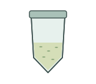](bacterial-culture-tube.svg) | [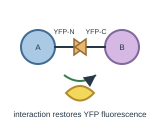](bifc.svg) | [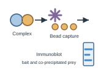](co-immunoprecipitation.svg) | [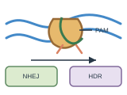](crispr-cas9.svg) |

| Dual-luciferase reporter assay / 双荧光素酶报告实验 | Electrophoretic mobility shift assay / 电泳迁移率变动分析 | EMSA gel mobility shift / EMSA 凝胶迁移率变化 | GUS stained leaf / GUS 染色叶片 |
| --- | --- | --- | --- |
| [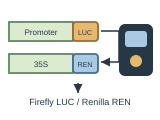](dual-luciferase.svg) | [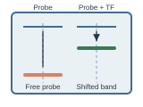](emsa.svg) | [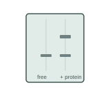](emsa-gel-shift.svg) |  |

| GUS stained root / GUS 染色根系 | GUS stained tissue section / GUS 染色组织切片 | Histochemical staining vial / 组织化学染色瓶 | Leaf syringe infiltration / 叶片注射渗透 |
| --- | --- | --- | --- |
| [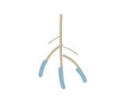](gus-stained-root.svg) | [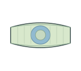](gus-stained-tissue-section.svg) |  | [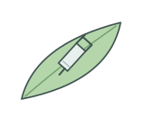](leaf-infiltration-syringe.svg) |

| Luciferase reporter leaf / 荧光素酶报告叶片 | Promoter GUS reporter construct / 启动子 GUS 报告载体元件 | Promoter LUC reporter construct / 启动子 LUC 报告载体元件 | qPCR fluorescence tubes / qPCR 荧光反应管 |
| --- | --- | --- | --- |
|  | [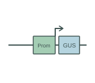](promoter-gus-reporter.svg) | [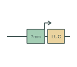](promoter-luciferase-reporter.svg) | [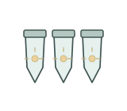](qpcr-fluorescence-tubes.svg) |

| Western blot strip / 蛋白免疫印迹条带 | Yeast one-hybrid assay / 酵母单杂交 |  |  |
| --- | --- | --- | --- |
|  | [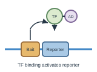](yeast-one-hybrid.svg) |  |  |

## Use and metadata | 使用与元数据

These assets are conceptual schematics. Adapt anatomy, labels, relationships and example data to the study. 此处素材为概念示意图，使用时应结合研究核对结构、标注、关系及示例数据。

See the [icon index](../../../metadata/icon-index.csv) for source, creator, license and review status. 来源、创作者、授权与审核状态见图标索引。Assets marked `not-assigned` have no assigned reuse license. 标记为 `not-assigned` 的素材尚未确定再利用授权。
