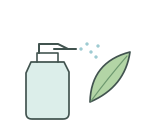
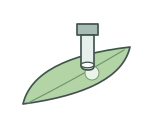
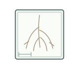
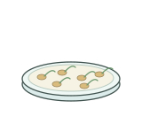
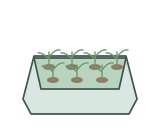

# Plant phenotyping | 植物表型测量

[All categories / 全部分类](../../README.md) · [Experimental methods and equipment / 实验方法与设备](../README.md) · [Repository / 仓库主页](../../../README.md)

**12 editable SVGs / 12 个可编辑 SVG**

Browse plant phenotyping illustrations below. Click an image to open its editable SVG. 本目录收录植物表型测量素材，点击预览可打开 SVG 源文件。

| Foliar spraying / 叶面喷施 | Hydroponic plant / 水培植株 | Leaf chlorophyll meter / 叶片叶绿素仪 | Leaf disc punch / 叶片打孔器 |
| --- | --- | --- | --- |
|  |  |  |  |

| Leaf gas-exchange chamber / 叶片气体交换叶室 | Plant in pot / 盆栽植株 | Plant label / 植物标牌 | Plant sample bag / 植物样品袋 |
| --- | --- | --- | --- |
|  |  |  |  |

| Root imaging tray / 根系成像托盘 | Root rinsing / 根系冲洗 | Seed germination dish / 培养皿种子萌发 | Seedling tray / 育苗盘 |
| --- | --- | --- | --- |
|  |  |  |  |

## Use and metadata | 使用与元数据

These assets are conceptual schematics. Adapt anatomy, labels, relationships and example data to the study. 此处素材为概念示意图，使用时应结合研究核对结构、标注、关系及示例数据。

See the [icon index](../../../metadata/icon-index.csv) for source, creator, license and review status. 来源、创作者、授权与审核状态见图标索引。Assets marked `not-assigned` have no assigned reuse license. 标记为 `not-assigned` 的素材尚未确定再利用授权。
