# Plant physiology | 植物生理实验

[All categories / 全部分类](../../README.md) · [Experimental methods and equipment / 实验方法与设备](../README.md) · [Repository / 仓库主页](../../../README.md)

**12 editable SVGs / 12 个可编辑 SVG**

Browse plant physiology illustrations below. Click an image to open its editable SVG. 本目录收录植物生理实验素材，点击预览可打开 SVG 源文件。

| Electrolyte leakage sample / 电解质渗漏测定样品 | Fresh biomass weighing / 鲜重称量 | Ion analysis sample tubes / 离子含量测定样品管 | Leaf pigment extraction tube / 叶片色素提取管 |
| --- | --- | --- | --- |
| [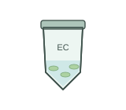](electrolyte-leakage-sample.svg) | [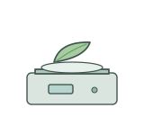](fresh-biomass-balance.svg) | [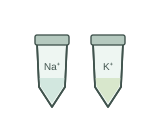](ion-analysis-samples.svg) |  |

| Leaf water-content sample / 叶片含水量样品 | Root and shoot separation / 根与地上部取样 | Root length measurement / 根长测量 | Salt solution flask / 盐溶液配制 |
| --- | --- | --- | --- |
| [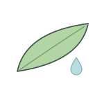](leaf-water-content-sample.svg) | [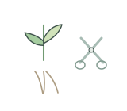](root-shoot-separation.svg) | [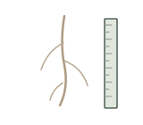](root-length-measurement.svg) | [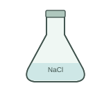](salt-solution-flask.svg) |

| Salt treatment germination dish / 盐处理萌发培养皿 | Salt treatment hydroponic vessel / 盐处理水培容器 | Shoot height measurement / 地上部高度测量 | Stained root sample / 根系染色样品 |
| --- | --- | --- | --- |
| [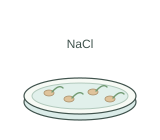](salt-seed-germination.svg) | [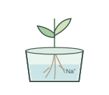](salt-hydroponic-treatment.svg) | [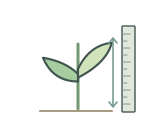](shoot-height-measurement.svg) | [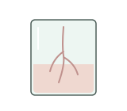](stained-root-sample.svg) |

## Use and metadata | 使用与元数据

These assets are conceptual schematics. Adapt anatomy, labels, relationships and example data to the study. 此处素材为概念示意图，使用时应结合研究核对结构、标注、关系及示例数据。

See the [icon index](../../../metadata/icon-index.csv) for source, creator, license and review status. 来源、创作者、授权与审核状态见图标索引。Assets marked `not-assigned` have no assigned reuse license. 标记为 `not-assigned` 的素材尚未确定再利用授权。
