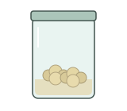
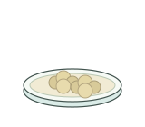
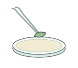
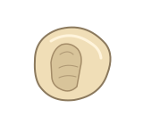
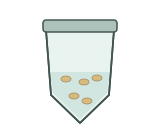
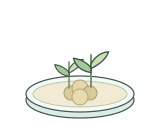
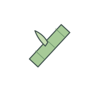

# Plant tissue culture | 植物组织培养

[All categories / 全部分类](../../README.md) · [Experimental methods and equipment / 实验方法与设备](../README.md) · [Repository / 仓库主页](../../../README.md)

**12 editable SVGs / 12 个可编辑 SVG**

Browse plant tissue culture illustrations below. Click an image to open its editable SVG. 本目录收录植物组织培养素材，点击预览可打开 SVG 源文件。

| Callus culture vessel / 愈伤组织培养瓶 | Callus on medium / 培养基上的愈伤组织 | Explant on medium / 培养基上的外植体 | Explant transfer with forceps / 镊子转移外植体 |
| --- | --- | --- | --- |
|  |  |  |  |

| Liquid culture medium flask / 液体培养基锥形瓶 | Maize immature embryo explant / 玉米幼胚外植体 | Plant tissue culture vessel / 植物组织培养瓶 | Plantlet acclimatization / 组培苗移栽驯化 |
| --- | --- | --- | --- |
|  |  |  |  |

| Rooted plantlet in culture / 生根培养苗 | Seed surface sterilization / 种子表面消毒 | Shoot regeneration / 芽再生 | Stem segment explant / 茎段外植体 |
| --- | --- | --- | --- |
|  |  |  |  |

## Use and metadata | 使用与元数据

These assets are conceptual schematics. Adapt anatomy, labels, relationships and example data to the study. 此处素材为概念示意图，使用时应结合研究核对结构、标注、关系及示例数据。

See the [icon index](../../../metadata/icon-index.csv) for source, creator, license and review status. 来源、创作者、授权与审核状态见图标索引。Assets marked `not-assigned` have no assigned reuse license. 标记为 `not-assigned` 的素材尚未确定再利用授权。
