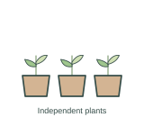
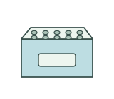
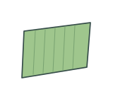
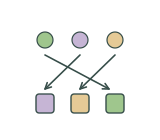
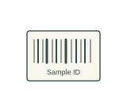
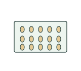
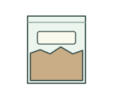
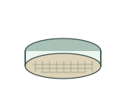
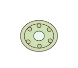

# Specimen preparation | 样品制备

[All categories / 全部分类](../../README.md) · [Experimental methods and equipment / 实验方法与设备](../README.md) · [Repository / 仓库主页](../../../README.md)

**12 editable SVGs / 12 个可编辑 SVG**

Browse specimen preparation illustrations below. Click an image to open its editable SVG. 本目录收录样品制备素材，点击预览可打开 SVG 源文件。

| Biological replicates / 生物学重复 | Cryogenic sample box / 冻存样品盒 | Ice bucket / 冰桶 | Leaf blade segment / 叶片截段 |
| --- | --- | --- | --- |
|  |  |  |  |

| Pooled tissue sample / 混合组织样品 | Randomized sample allocation / 样品随机分配 | Root segment sample / 根段样品 | Sample barcode label / 样品条码标签 |
| --- | --- | --- | --- |
|  |  |  |  |

| Seed counting tray / 种子计数盘 | Soil sample bag / 土壤样品袋 | Soil sieve / 土壤筛 | Stem transverse slice / 茎横切片 |
| --- | --- | --- | --- |
|  |  |  |  |

## Use and metadata | 使用与元数据

These assets are conceptual schematics. Adapt anatomy, labels, relationships and example data to the study. 此处素材为概念示意图，使用时应结合研究核对结构、标注、关系及示例数据。

See the [icon index](../../../metadata/icon-index.csv) for source, creator, license and review status. 来源、创作者、授权与审核状态见图标索引。Assets marked `not-assigned` have no assigned reuse license. 标记为 `not-assigned` 的素材尚未确定再利用授权。
