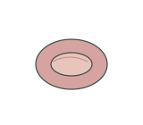
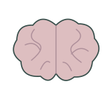
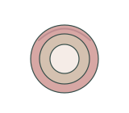

# Human biology | 人体生物学

[All categories / 全部分类](../README.md) · [Repository / 仓库主页](../../README.md)

Human organs, cells and tissue schematics. 人体器官、细胞与组织示意。

**36 SVGs · 3 subcategories / 36 个 SVG · 3 个子分类**

| Subcategory / 子分类 | SVGs / 数量 | Example / 示例 |
| --- | ---: | --- |
| [Cells / 细胞](cells/README.md) | 12 |  |
| [Organs / 器官](organs/README.md) | 12 |  |
| [Tissues / 组织](tissues/README.md) | 12 |  |

Each subcategory README includes all previews and SVG links. 每个子分类 README 提供完整预览及 SVG 链接。
