# Cells | 细胞

[All categories / 全部分类](../../README.md) · [Human biology / 人体生物学](../README.md) · [Repository / 仓库主页](../../../README.md)

**12 editable SVGs / 12 个可编辑 SVG**

Browse cells illustrations below. Click an image to open its editable SVG. 本目录收录细胞素材，点击预览可打开 SVG 源文件。

| Adipocyte / 脂肪细胞 | Chondrocyte / 软骨细胞 | Endothelial cell / 内皮细胞 | Enterocyte / 肠吸收细胞 |
| --- | --- | --- | --- |
| [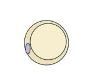](adipocyte.svg) | [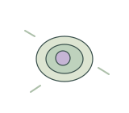](chondrocyte.svg) | [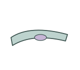](endothelial-cell.svg) | [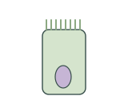](enterocyte.svg) |

| Erythrocyte / 红细胞 | Fibroblast / 成纤维细胞 | Goblet cell / 杯状细胞 | Hepatocyte / 肝细胞 |
| --- | --- | --- | --- |
| [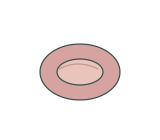](erythrocyte.svg) | [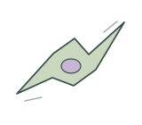](fibroblast.svg) | [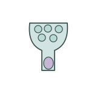](goblet-cell.svg) | [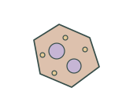](hepatocyte.svg) |

| Neuron / 神经元 | Osteocyte / 骨细胞 | Skeletal myofiber / 骨骼肌纤维 | Smooth muscle cell / 平滑肌细胞 |
| --- | --- | --- | --- |
| [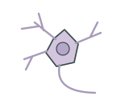](neuron.svg) | [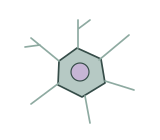](osteocyte.svg) | [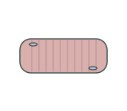](skeletal-myofiber.svg) | [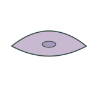](smooth-muscle-cell.svg) |

## Use and metadata | 使用与元数据

These assets are conceptual schematics. Adapt anatomy, labels, relationships and example data to the study. 此处素材为概念示意图，使用时应结合研究核对结构、标注、关系及示例数据。

See the [icon index](../../../metadata/icon-index.csv) for source, creator, license and review status. 来源、创作者、授权与审核状态见图标索引。Assets marked `not-assigned` have no assigned reuse license. 标记为 `not-assigned` 的素材尚未确定再利用授权。
