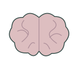
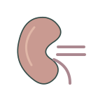
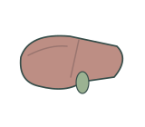
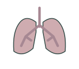
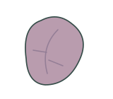
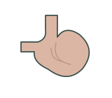
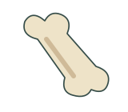
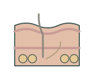
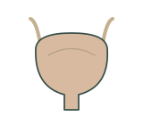

# Organs | 器官

[All categories / 全部分类](../../README.md) · [Human biology / 人体生物学](../README.md) · [Repository / 仓库主页](../../../README.md)

**12 editable SVGs / 12 个可编辑 SVG**

Browse organs illustrations below. Click an image to open its editable SVG. 本目录收录器官素材，点击预览可打开 SVG 源文件。

| Human brain / 人脑 | Human heart / 人心脏 | Human intestine / 人肠道 | Human kidney / 人肾脏 |
| --- | --- | --- | --- |
|  |  |  |  |

| Human liver / 人肝脏 | Human lungs / 人肺 | Human pancreas / 人胰腺 | Human spleen / 人脾脏 |
| --- | --- | --- | --- |
|  |  |  |  |

| Human stomach / 人胃 | Long bone / 长骨 | Skin cross section / 皮肤横切面 | Urinary bladder / 膀胱 |
| --- | --- | --- | --- |
|  |  |  |  |

## Use and metadata | 使用与元数据

These assets are conceptual schematics. Adapt anatomy, labels, relationships and example data to the study. 此处素材为概念示意图，使用时应结合研究核对结构、标注、关系及示例数据。

See the [icon index](../../../metadata/icon-index.csv) for source, creator, license and review status. 来源、创作者、授权与审核状态见图标索引。Assets marked `not-assigned` have no assigned reuse license. 标记为 `not-assigned` 的素材尚未确定再利用授权。
