# Tissues | 组织

[All categories / 全部分类](../../README.md) · [Human biology / 人体生物学](../README.md) · [Repository / 仓库主页](../../../README.md)

**12 editable SVGs / 12 个可编辑 SVG**

Browse tissues illustrations below. Click an image to open its editable SVG. 本目录收录组织素材，点击预览可打开 SVG 源文件。

| Alveolar cluster / 肺泡簇 | Artery cross section / 动脉横切面 | Capillary / 毛细血管 | Hyaline cartilage / 透明软骨 |
| --- | --- | --- | --- |
| [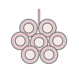](alveolar-cluster.svg) | [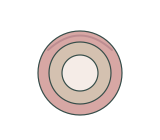](artery-cross-section.svg) | [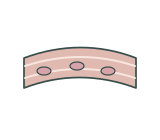](capillary-tissue.svg) | [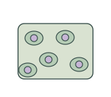](hyaline-cartilage.svg) |

| Intestinal villus / 肠绒毛 | Lymph node section / 淋巴结切面 | Nephron concept / 肾单位示意 | Peripheral nerve section / 外周神经横切面 |
| --- | --- | --- | --- |
| [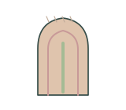](intestinal-villus.svg) | [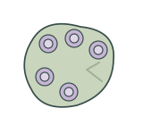](lymph-node-section.svg) | [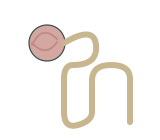](nephron-concept.svg) | [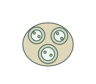](peripheral-nerve-section.svg) |

| Skeletal muscle bundle / 骨骼肌束 | Smooth muscle tissue / 平滑肌组织 | Tendon tissue / 肌腱组织 | Vein cross section / 静脉横切面 |
| --- | --- | --- | --- |
| [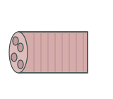](skeletal-muscle-bundle.svg) | [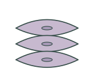](smooth-muscle-tissue.svg) | [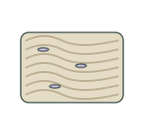](tendon-tissue.svg) |  |

## Use and metadata | 使用与元数据

These assets are conceptual schematics. Adapt anatomy, labels, relationships and example data to the study. 此处素材为概念示意图，使用时应结合研究核对结构、标注、关系及示例数据。

See the [icon index](../../../metadata/icon-index.csv) for source, creator, license and review status. 来源、创作者、授权与审核状态见图标索引。Assets marked `not-assigned` have no assigned reuse license. 标记为 `not-assigned` 的素材尚未确定再利用授权。
