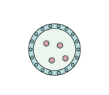
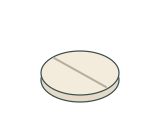

# Medicine and pharmaceutical illustrations | 医药素材

[All categories / 全部分类](../README.md) · [Repository / 仓库主页](../../README.md)

Dosage forms and delivery-system schematics. 药物剂型和递送系统示意。

**24 SVGs · 2 subcategories / 24 个 SVG · 2 个子分类**

| Subcategory / 子分类 | SVGs / 数量 | Example / 示例 |
| --- | ---: | --- |
| [Drug delivery systems / 药物递送](delivery-systems/README.md) | 12 |  |
| [Dosage forms / 药物剂型](dosage-forms/README.md) | 12 |  |

Each subcategory README includes all previews and SVG links. 每个子分类 README 提供完整预览及 SVG 链接。
