# Drug delivery systems | 药物递送

[All categories / 全部分类](../../README.md) · [Medicine and pharmaceutical illustrations / 医药素材](../README.md) · [Repository / 仓库主页](../../../README.md)

**12 editable SVGs / 12 个可编辑 SVG**

Browse drug delivery systems illustrations below. Click an image to open its editable SVG. 本目录收录药物递送素材，点击预览可打开 SVG 源文件。

| Drug loaded liposome / 载药脂质体 | Drug micelle / 载药胶束 | Enteric coated tablet / 肠溶包衣片 | Hydrogel drug depot / 水凝胶药物储库 |
| --- | --- | --- | --- |
| [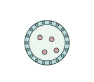](drug-loaded-liposome.svg) | [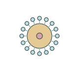](drug-micelle.svg) | [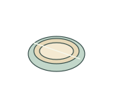](enteric-coated-tablet.svg) | [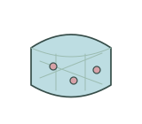](hydrogel-drug-depot.svg) |

| Implantable drug rod / 植入式药物棒 | Intravenous infusion bag / 静脉输液袋 | Nebulizer / 雾化器 | Oral dosing syringe / 口服给药注射器 |
| --- | --- | --- | --- |
| [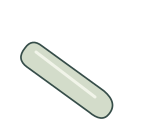](implantable-drug-rod.svg) | [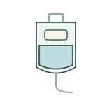](intravenous-infusion-bag.svg) | [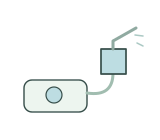](nebulizer-device.svg) | [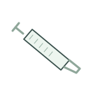](oral-dose-syringe.svg) |

| Polymeric nanoparticle / 聚合物纳米颗粒 | Porous tissue scaffold / 多孔组织支架 | Syringe pump / 注射泵 | Wound dressing / 伤口敷料 |
| --- | --- | --- | --- |
| [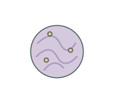](polymeric-nanoparticle.svg) | [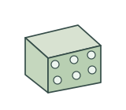](porous-tissue-scaffold.svg) | [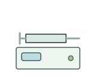](syringe-pump-device.svg) | [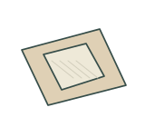](wound-dressing.svg) |

## Use and metadata | 使用与元数据

These assets are conceptual schematics. Adapt anatomy, labels, relationships and example data to the study. 此处素材为概念示意图，使用时应结合研究核对结构、标注、关系及示例数据。

See the [icon index](../../../metadata/icon-index.csv) for source, creator, license and review status. 来源、创作者、授权与审核状态见图标索引。Assets marked `not-assigned` have no assigned reuse license. 标记为 `not-assigned` 的素材尚未确定再利用授权。
