# Dosage forms | 药物剂型

[All categories / 全部分类](../../README.md) · [Medicine and pharmaceutical illustrations / 医药素材](../README.md) · [Repository / 仓库主页](../../../README.md)

**12 editable SVGs / 12 个可编辑 SVG**

Browse dosage forms illustrations below. Click an image to open its editable SVG. 本目录收录药物剂型素材，点击预览可打开 SVG 源文件。

| Blister pack / 泡罩包装 | Eye drop bottle / 滴眼液瓶 | Hard capsule / 硬胶囊 | Metered dose inhaler / 定量吸入器 |
| --- | --- | --- | --- |
| [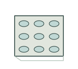](blister-pack.svg) | [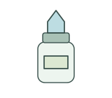](eye-drop-bottle.svg) | [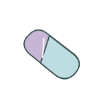](hard-capsule.svg) | [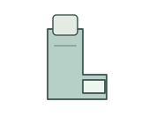](metered-dose-inhaler.svg) |

| Nasal spray bottle / 鼻喷剂瓶 | Ointment tube / 软膏管 | Oral liquid medicine / 口服液 | Oral tablet / 口服片剂 |
| --- | --- | --- | --- |
| [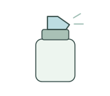](nasal-spray-bottle.svg) | [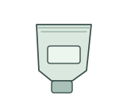](ointment-tube.svg) | [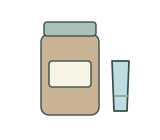](oral-liquid.svg) | [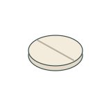](oral-tablet.svg) |

| Powder sachet / 药用粉剂袋 | Softgel capsule / 软胶囊 | Suppository / 栓剂 | Transdermal patch / 透皮贴剂 |
| --- | --- | --- | --- |
| [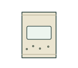](powder-sachet.svg) | [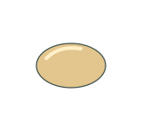](softgel-capsule.svg) | [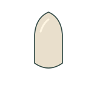](suppository.svg) | [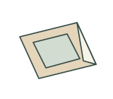](transdermal-patch.svg) |

## Use and metadata | 使用与元数据

These assets are conceptual schematics. Adapt anatomy, labels, relationships and example data to the study. 此处素材为概念示意图，使用时应结合研究核对结构、标注、关系及示例数据。

See the [icon index](../../../metadata/icon-index.csv) for source, creator, license and review status. 来源、创作者、授权与审核状态见图标索引。Assets marked `not-assigned` have no assigned reuse license. 标记为 `not-assigned` 的素材尚未确定再利用授权。
