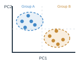
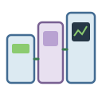
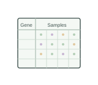

# Omics and data analysis | 组学与数据分析

[All categories / 全部分类](../README.md) · [Repository / 仓库主页](../../README.md)

Transcriptomics, proteomics, metabolomics, sequencing and data visualization. 转录组、蛋白组、代谢组、测序与数据分析。

**64 SVGs · 5 subcategories / 64 个 SVG · 5 个子分类**

| Subcategory / 子分类 | SVGs / 数量 | Example / 示例 |
| --- | ---: | --- |
| [Data analysis and statistical graphics / 数据分析与统计图示](analysis/README.md) | 19 |  |
| [Metabolomics / 代谢组学](metabolomics/README.md) | 16 |  |
| [Proteomics / 蛋白质组学](proteomics/README.md) | 16 |  |
| [Sequencing / 测序](sequencing/README.md) | 1 |  |
| [Transcriptomics / 转录组学](transcriptomics/README.md) | 12 |  |

Each subcategory README includes all previews and SVG links. 每个子分类 README 提供完整预览及 SVG 链接。
