# Data analysis and statistical graphics | 数据分析与统计图示

[All categories / 全部分类](../../README.md) · [Omics and data analysis / 组学与数据分析](../README.md) · [Repository / 仓库主页](../../../README.md)

**19 editable SVGs / 19 个可编辑 SVG**

Browse data analysis and statistical graphics illustrations below. Click an image to open its editable SVG. 本目录收录数据分析与统计图示素材，点击预览可打开 SVG 源文件。

| Box plot / 箱线图 | Correlation scatter plot / 相关散点图 | Cumulative distribution / 累积分布图 | Density distribution / 密度分布图 |
| --- | --- | --- | --- |
| [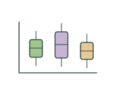](box-plot-concept.svg) | [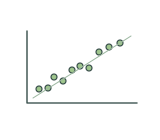](correlation-scatter.svg) | [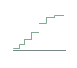](empirical-cumulative-distribution.svg) | [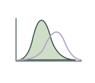](density-distribution.svg) |

| Effect size interval / 效应量区间 | Enrichment dot plot / 富集气泡图 | Forest plot / 森林图 | Gene set enrichment analysis / 基因集富集分析 |
| --- | --- | --- | --- |
| [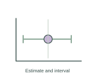](effect-size-interval.svg) | [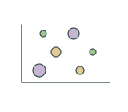](enrichment-dot-plot.svg) | [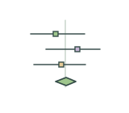](forest-plot-concept.svg) | [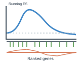](gsea-enrichment.svg) |

| GWAS Manhattan plot / GWAS 曼哈顿图 | Hierarchical dendrogram / 层次聚类树 | Missing data pattern / 缺失数据分布 | Phylogenetic tree / 系统发育树 |
| --- | --- | --- | --- |
| [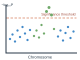](gwas-manhattan.svg) | [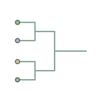](hierarchical-dendrogram.svg) | [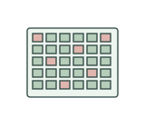](missing-data-pattern.svg) | [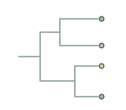](phylogenetic-tree-concept.svg) |

| Principal component analysis plot / 主成分分析图 | Protein-protein interaction network / 蛋白质互作网络 | QTL interval mapping / QTL 区间定位图 | Set intersection / 集合交集 |
| --- | --- | --- | --- |
| [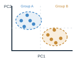](pca-plot.svg) | [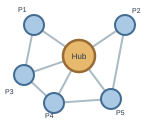](ppi-network.svg) | [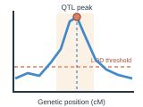](qtl-interval.svg) | [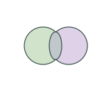](set-intersection-venn.svg) |

| UMAP embedding plot / UMAP 降维图 | Violin plot / 小提琴图 | WGCNA co-expression network / WGCNA 共表达网络 |  |
| --- | --- | --- | --- |
| [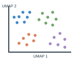](umap-plot.svg) | [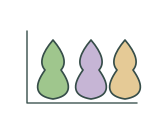](violin-plot-concept.svg) | [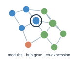](wgcna-network.svg) |  |

## Use and metadata | 使用与元数据

These assets are conceptual schematics. Adapt anatomy, labels, relationships and example data to the study. 此处素材为概念示意图，使用时应结合研究核对结构、标注、关系及示例数据。

See the [icon index](../../../metadata/icon-index.csv) for source, creator, license and review status. 来源、创作者、授权与审核状态见图标索引。Assets marked `not-assigned` have no assigned reuse license. 标记为 `not-assigned` 的素材尚未确定再利用授权。
