# Metabolomics | 代谢组学

[All categories / 全部分类](../../README.md) · [Omics and data analysis / 组学与数据分析](../README.md) · [Repository / 仓库主页](../../../README.md)

**16 editable SVGs / 16 个可编辑 SVG**

Browse metabolomics illustrations below. Click an image to open its editable SVG. 本目录收录代谢组学素材，点击预览可打开 SVG 源文件。

| Autosampler vial / 自动进样瓶 | Chromatogram / 色谱图 | Chromatographic gradient / 色谱梯度 | Extracted ion chromatogram / 提取离子流色谱图 |
| --- | --- | --- | --- |
| [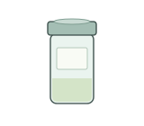](autosampler-vial.svg) | [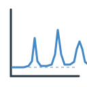](chromatogram.svg) | [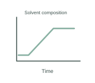](chromatographic-gradient.svg) | [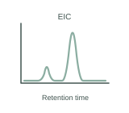](extracted-ion-chromatogram.svg) |

| LC-MS system / 液相色谱-质谱系统 | Liquid phase partitioning / 液液分相 | Metabolite annotation / 代谢物注释 | Metabolite extraction / 代谢物提取 |
| --- | --- | --- | --- |
|  |  | [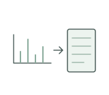](metabolite-annotation.svg) |  |

| Metabolite feature matrix / 代谢特征矩阵 | Metabolite network / 代谢物网络 | Sample drying under gas / 气流吹干样品 | Sample filtration / 样品过滤 |
| --- | --- | --- | --- |
| [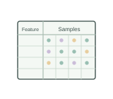](metabolite-feature-matrix.svg) |  | [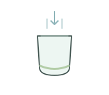](nitrogen-sample-drying.svg) | [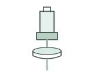](sample-filtration.svg) |

| Sample reconstitution / 样品复溶 | Tissue homogenization / 组织匀浆 | Ultrasonic bath / 超声水浴 | Vortex mixing / 涡旋混匀 |
| --- | --- | --- | --- |
| [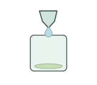](sample-reconstitution.svg) |  | [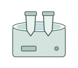](ultrasonic-bath.svg) | [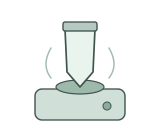](vortex-mixing.svg) |

## Use and metadata | 使用与元数据

These assets are conceptual schematics. Adapt anatomy, labels, relationships and example data to the study. 此处素材为概念示意图，使用时应结合研究核对结构、标注、关系及示例数据。

See the [icon index](../../../metadata/icon-index.csv) for source, creator, license and review status. 来源、创作者、授权与审核状态见图标索引。Assets marked `not-assigned` have no assigned reuse license. 标记为 `not-assigned` 的素材尚未确定再利用授权。
