# Proteomics | 蛋白质组学

[All categories / 全部分类](../../README.md) · [Omics and data analysis / 组学与数据分析](../README.md) · [Repository / 仓库主页](../../../README.md)

**16 editable SVGs / 16 个可编辑 SVG**

Browse proteomics illustrations below. Click an image to open its editable SVG. 本目录收录蛋白质组学素材，点击预览可打开 SVG 源文件。

| Electrospray ion source / 电喷雾离子源 | Gel electrophoresis / 凝胶电泳 | Liquid chromatography column / 液相色谱柱 | Mass spectrometer / 质谱仪 |
| --- | --- | --- | --- |
| [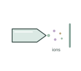](electrospray-ion-source.svg) |  | [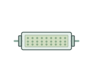](liquid-chromatography-column.svg) |  |

| MS1 precursor spectrum / MS1 前体离子谱 | Peptide desalting tip / 肽段脱盐枪头 | Peptide mass spectrum / 肽段质谱图 | Peptide spectrum match / 肽谱匹配 |
| --- | --- | --- | --- |
| [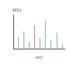](ms1-precursor-spectrum.svg) |  | [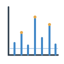](peptide-spectrum.svg) | [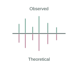](peptide-spectrum-match.svg) |

| Precursor isolation window / 前体离子隔离窗口 | Protease digestion / 蛋白酶解 | Protein abundance heatmap / 蛋白丰度热图 | Protein abundance matrix / 蛋白丰度矩阵 |
| --- | --- | --- | --- |
| [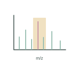](precursor-isolation.svg) | [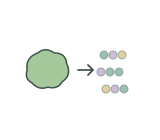](protease-digestion.svg) |  | [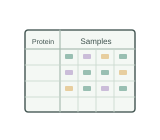](protein-abundance-matrix.svg) |

| Protein extraction tube / 蛋白质提取管 | Protein inference / 蛋白推断 | Protein quantification plate / 蛋白浓度测定板 | Tandem MS fragmentation / 串联质谱碎裂 |
| --- | --- | --- | --- |
| [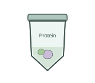](protein-extraction-tube.svg) | [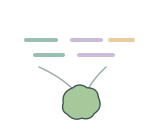](protein-inference.svg) | [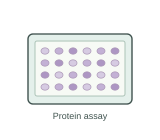](protein-quantification-plate.svg) | [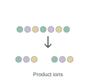](tandem-ms-fragmentation.svg) |

## Use and metadata | 使用与元数据

These assets are conceptual schematics. Adapt anatomy, labels, relationships and example data to the study. 此处素材为概念示意图，使用时应结合研究核对结构、标注、关系及示例数据。

See the [icon index](../../../metadata/icon-index.csv) for source, creator, license and review status. 来源、创作者、授权与审核状态见图标索引。Assets marked `not-assigned` have no assigned reuse license. 标记为 `not-assigned` 的素材尚未确定再利用授权。
