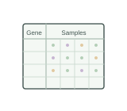
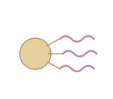
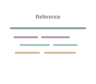
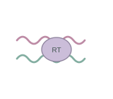
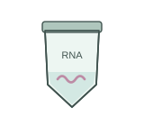
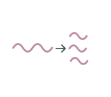
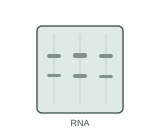
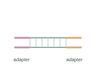
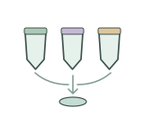

# Transcriptomics | 转录组学

[All categories / 全部分类](../../README.md) · [Omics and data analysis / 组学与数据分析](../README.md) · [Repository / 仓库主页](../../../README.md)

**12 editable SVGs / 12 个可编辑 SVG**

Browse transcriptomics illustrations below. Click an image to open its editable SVG. 本目录收录转录组学素材，点击预览可打开 SVG 源文件。

| Gene count matrix / 基因计数矩阵 | Plant tissue sample for RNA / 转录组植物组织样品 | Poly(A) mRNA capture / Poly(A) mRNA 富集 | Read reference alignment / 测序序列比对参考基因组 |
| --- | --- | --- | --- |
|  |  |  |  |

| Reverse transcription / 逆转录 | RNA extraction tube / RNA 提取管 | RNA fragmentation / RNA 片段化 | RNA integrity gel / RNA 完整性凝胶 |
| --- | --- | --- | --- |
|  |  |  |  |

| Sequencing adapter ligation / 测序接头连接 | Sequencing flow cell / 测序流动池 | Sequencing library pooling / 测序文库混合 | Sequencing library tube / 测序文库管 |
| --- | --- | --- | --- |
|  |  |  |  |

## Use and metadata | 使用与元数据

These assets are conceptual schematics. Adapt anatomy, labels, relationships and example data to the study. 此处素材为概念示意图，使用时应结合研究核对结构、标注、关系及示例数据。

See the [icon index](../../../metadata/icon-index.csv) for source, creator, license and review status. 来源、创作者、授权与审核状态见图标索引。Assets marked `not-assigned` have no assigned reuse license. 标记为 `not-assigned` 的素材尚未确定再利用授权。
