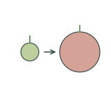
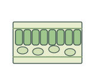
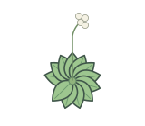
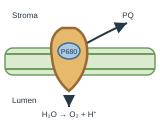
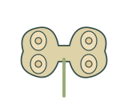
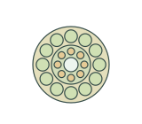
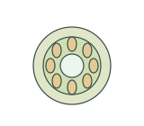

# Plant biology | 植物生物学

[All categories / 全部分类](../README.md) · [Repository / 仓库主页](../../README.md)

Whole plants, organs, tissues, development and photosynthesis. 植株、器官、组织、发育与光合作用。

**106 SVGs · 11 subcategories / 106 个 SVG · 11 个子分类**

| Subcategory / 子分类 | SVGs / 数量 | Example / 示例 |
| --- | ---: | --- |
| [Plant anatomy / 植物解剖](anatomy/README.md) | 6 |  |
| [Chloroplast structure / 叶绿体结构](chloroplasts/README.md) | 3 |  |
| [Development and ecology / 发育与生态](development-ecology/README.md) | 12 |  |
| [Leaf tissues / 叶片组织](leaf-tissues/README.md) | 12 |  |
| [Crop organs and morphology / 作物器官与形态](morphology/README.md) | 22 |  |
| [Photosynthesis / 光合作用](photosynthesis/README.md) | 6 |  |
| [Reproductive tissues / 生殖组织](reproductive-tissues/README.md) | 12 |  |
| [Root tissues / 根组织](root-tissues/README.md) | 12 |  |
| [Stem tissues / 茎组织](stem-tissues/README.md) | 12 |  |
| [Tissues / 组织](tissues/README.md) | 6 |  |
| [Whole plants / 植株](whole-plants/README.md) | 3 |  |

Each subcategory README includes all previews and SVG links. 每个子分类 README 提供完整预览及 SVG 链接。
