# Development and ecology | 发育与生态

[All categories / 全部分类](../../README.md) · [Plant biology / 植物生物学](../README.md) · [Repository / 仓库主页](../../../README.md)

**12 editable SVGs / 12 个可编辑 SVG**

Browse development and ecology illustrations below. Click an image to open its editable SVG. 本目录收录发育与生态素材，点击预览可打开 SVG 源文件。

| Fruit development / 果实发育 | Mycorrhizal association / 菌根互作 | Plant graft union / 植物嫁接接口 | Pollen tube growth / 花粉管伸长 |
| --- | --- | --- | --- |
| [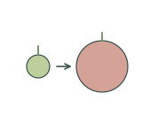](fruit-development.svg) | [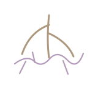](mycorrhizal-association.svg) | [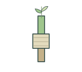](graft-union.svg) | [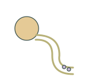](pollen-tube-growth.svg) |

| Root exudation / 根系分泌 | Root gravitropism / 根向重力性 | Root nodule section / 根瘤切面 | Root surface biofilm / 根表生物膜 |
| --- | --- | --- | --- |
| [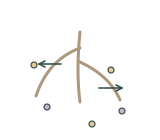](root-exudation.svg) | [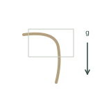](root-gravitropism.svg) | [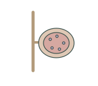](root-nodule-section.svg) | [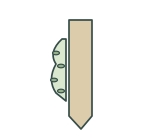](root-surface-biofilm.svg) |

| Seed dispersal / 种子传播 | Seed dormancy / 种子休眠 | Seedling growth comparison / 幼苗生长比较 | Shoot phototropism / 茎向光性 |
| --- | --- | --- | --- |
| [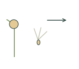](seed-dispersal.svg) | [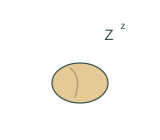](seed-dormancy.svg) |  | [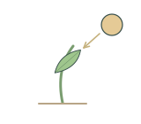](shoot-phototropism.svg) |

## Use and metadata | 使用与元数据

These assets are conceptual schematics. Adapt anatomy, labels, relationships and example data to the study. 此处素材为概念示意图，使用时应结合研究核对结构、标注、关系及示例数据。

See the [icon index](../../../metadata/icon-index.csv) for source, creator, license and review status. 来源、创作者、授权与审核状态见图标索引。Assets marked `not-assigned` have no assigned reuse license. 标记为 `not-assigned` 的素材尚未确定再利用授权。
