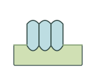
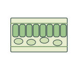
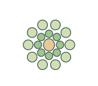
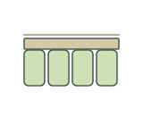
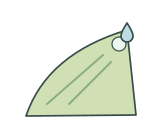
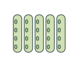
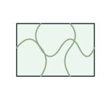
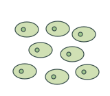
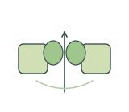

# Leaf tissues | 叶片组织

[All categories / 全部分类](../../README.md) · [Plant biology / 植物生物学](../README.md) · [Repository / 仓库主页](../../../README.md)

**12 editable SVGs / 12 个可编辑 SVG**

Browse leaf tissues illustrations below. Click an image to open its editable SVG. 本目录收录叶片组织素材，点击预览可打开 SVG 源文件。

| Bulliform cells / 泡状细胞 | Dicot leaf section / 双子叶植物叶片切面 | Glandular trichome / 腺毛 | Grass guard cells / 禾本科保卫细胞 |
| --- | --- | --- | --- |
|  |  |  |  |

| Kranz anatomy concept / 花环结构示意 | Leaf cuticle / 叶片角质层 | Leaf hydathode / 叶片水孔 | Monocot leaf section / 单子叶植物叶片切面 |
| --- | --- | --- | --- |
|  |  |  |  |

| Palisade mesophyll / 栅栏叶肉 | Pavement epidermal tissue / 表皮铺路细胞组织 | Spongy mesophyll / 海绵叶肉 | Stomatal pore section / 气孔孔隙切面 |
| --- | --- | --- | --- |
|  |  |  |  |

## Use and metadata | 使用与元数据

These assets are conceptual schematics. Adapt anatomy, labels, relationships and example data to the study. 此处素材为概念示意图，使用时应结合研究核对结构、标注、关系及示例数据。

See the [icon index](../../../metadata/icon-index.csv) for source, creator, license and review status. 来源、创作者、授权与审核状态见图标索引。Assets marked `not-assigned` have no assigned reuse license. 标记为 `not-assigned` 的素材尚未确定再利用授权。
