# Crop organs and morphology | 作物器官与形态

[All categories / 全部分类](../../README.md) · [Plant biology / 植物生物学](../README.md) · [Repository / 仓库主页](../../../README.md)

**22 editable SVGs / 22 个可编辑 SVG**

Browse crop organs and morphology illustrations below. Click an image to open its editable SVG. 本目录收录作物器官与形态素材，点击预览可打开 SVG 源文件。

| Arabidopsis rosette / 拟南芥莲座叶 | Foxtail millet panicle / 谷子穗 | Germinating maize kernel / 萌发玉米籽粒 | Lateral root emergence / 侧根发生 |
| --- | --- | --- | --- |
| [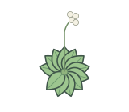](arabidopsis-rosette.svg) | [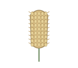](foxtail-millet-panicle.svg) | [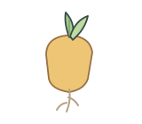](germinating-maize-kernel.svg) | [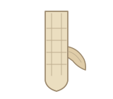](lateral-root-emergence.svg) |

| Leaf disc / 叶圆片 | Legume root nodules / 豆科植物根瘤 | Maize crown root system / 玉米冠根 | Maize ear silk / 玉米花丝 |
| --- | --- | --- | --- |
|  | [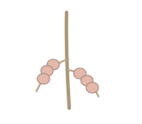](legume-root-nodules.svg) | [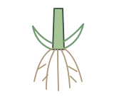](maize-crown-root-system.svg) | [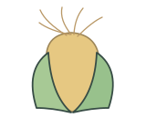](maize-ear-silk.svg) |

| Maize ear with exposed kernels / 玉米果穗 | Maize kernel / 玉米籽粒 | Maize kernel longitudinal section / 玉米籽粒纵切面 | Maize leaf with parallel veins / 玉米叶片平行叶脉 |
| --- | --- | --- | --- |
| [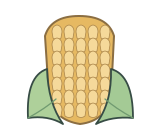](maize-ear.svg) |  | [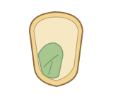](maize-kernel-longitudinal-section.svg) |  |

| Maize plant / 玉米植株 | Maize pollen grain / 玉米花粉粒 | Maize tassel / 玉米雄穗 | Open cotton boll / 吐絮棉铃 |
| --- | --- | --- | --- |
| [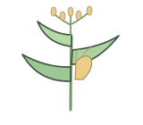](maize-whole-plant.svg) | [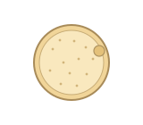](maize-pollen-grain.svg) | [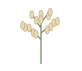](maize-tassel.svg) |  |

| Potato tuber / 马铃薯块茎 | Rice panicle / 水稻圆锥花序 | Sorghum panicle / 高粱圆锥花序 | Soybean pod / 大豆豆荚 |
| --- | --- | --- | --- |
| [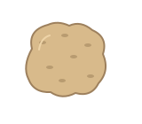](potato-tuber.svg) | [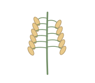](rice-panicle.svg) | [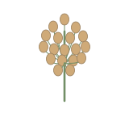](sorghum-panicle.svg) |  |

| Tomato fruit / 番茄果实 | Wheat spike / 小麦穗 |  |  |
| --- | --- | --- | --- |
| [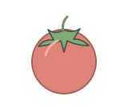](tomato-fruit.svg) | [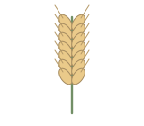](wheat-spike.svg) |  |  |

## Use and metadata | 使用与元数据

These assets are conceptual schematics. Adapt anatomy, labels, relationships and example data to the study. 此处素材为概念示意图，使用时应结合研究核对结构、标注、关系及示例数据。

See the [icon index](../../../metadata/icon-index.csv) for source, creator, license and review status. 来源、创作者、授权与审核状态见图标索引。Assets marked `not-assigned` have no assigned reuse license. 标记为 `not-assigned` 的素材尚未确定再利用授权。
