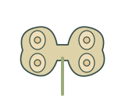
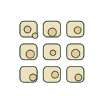
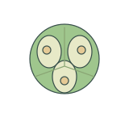
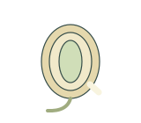
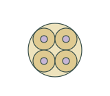
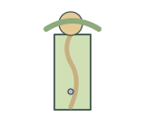
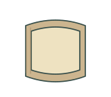

# Reproductive tissues | 生殖组织

[All categories / 全部分类](../../README.md) · [Plant biology / 植物生物学](../README.md) · [Repository / 仓库主页](../../../README.md)

**12 editable SVGs / 12 个可编辑 SVG**

Browse reproductive tissues illustrations below. Click an image to open its editable SVG. 本目录收录生殖组织素材，点击预览可打开 SVG 源文件。

| Anther cross section / 花药横切面 | Endosperm tissue / 胚乳组织 | Floral meristem concept / 花分生组织示意 | Ovary cross section / 子房横切面 |
| --- | --- | --- | --- |
|  |  |  |  |

| Ovule section / 胚珠切面 | Petal / 花瓣 | Pistil / 雌蕊 | Pollen tetrad / 花粉四分体 |
| --- | --- | --- | --- |
|  |  |  |  |

| Pollen tube in style / 花柱内花粉管 | Seed coat tissue / 种皮组织 | Sepal / 萼片 | Stigma surface / 柱头表面 |
| --- | --- | --- | --- |
|  |  |  |  |

## Use and metadata | 使用与元数据

These assets are conceptual schematics. Adapt anatomy, labels, relationships and example data to the study. 此处素材为概念示意图，使用时应结合研究核对结构、标注、关系及示例数据。

See the [icon index](../../../metadata/icon-index.csv) for source, creator, license and review status. 来源、创作者、授权与审核状态见图标索引。Assets marked `not-assigned` have no assigned reuse license. 标记为 `not-assigned` 的素材尚未确定再利用授权。
