# Root tissues | 根组织

[All categories / 全部分类](../../README.md) · [Plant biology / 植物生物学](../README.md) · [Repository / 仓库主页](../../../README.md)

**12 editable SVGs / 12 个可编辑 SVG**

Browse root tissues illustrations below. Click an image to open its editable SVG. 本目录收录根组织素材，点击预览可打开 SVG 源文件。

| Casparian strip concept / 凯氏带示意 | Dicot root section / 双子叶植物根横切面 | Endodermal ring / 内皮层环 | Exodermal tissue / 外皮层组织 |
| --- | --- | --- | --- |
| [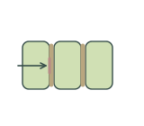](casparian-strip.svg) | [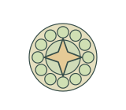](dicot-root-section.svg) | [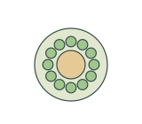](endodermal-ring.svg) | [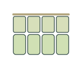](exodermal-tissue.svg) |

| Monocot root section / 单子叶植物根横切面 | Pericycle layer / 中柱鞘层 | Root aerenchyma / 根通气组织 | Root cap statolith concept / 根冠平衡石示意 |
| --- | --- | --- | --- |
| [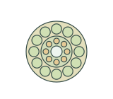](monocot-root-section.svg) | [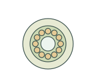](pericycle-layer.svg) | [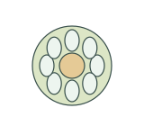](root-aerenchyma.svg) | [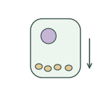](root-cap-statoliths.svg) |

| Root cortex tissue / 根皮层组织 | Root meristematic tissue / 根分生组织 | Root quiescent center concept / 根静止中心示意 | Root vascular cylinder / 根中柱 |
| --- | --- | --- | --- |
| [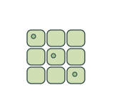](root-cortex.svg) | [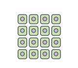](root-meristem-tissue.svg) | [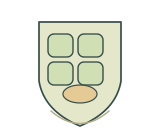](quiescent-center-concept.svg) | [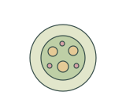](root-vascular-cylinder.svg) |

## Use and metadata | 使用与元数据

These assets are conceptual schematics. Adapt anatomy, labels, relationships and example data to the study. 此处素材为概念示意图，使用时应结合研究核对结构、标注、关系及示例数据。

See the [icon index](../../../metadata/icon-index.csv) for source, creator, license and review status. 来源、创作者、授权与审核状态见图标索引。Assets marked `not-assigned` have no assigned reuse license. 标记为 `not-assigned` 的素材尚未确定再利用授权。
