# Stem tissues | 茎组织

[All categories / 全部分类](../../README.md) · [Plant biology / 植物生物学](../README.md) · [Repository / 仓库主页](../../../README.md)

**12 editable SVGs / 12 个可编辑 SVG**

Browse stem tissues illustrations below. Click an image to open its editable SVG. 本目录收录茎组织素材，点击预览可打开 SVG 源文件。

| Annual growth rings / 年轮 | Collateral vascular bundle / 外韧维管束 | Collenchyma tissue / 厚角组织 | Cork tissue / 木栓组织 |
| --- | --- | --- | --- |
| [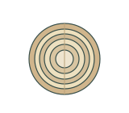](annual-growth-rings.svg) | [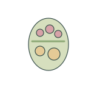](collateral-vascular-bundle.svg) | [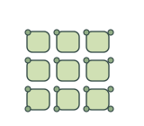](collenchyma-tissue.svg) | [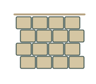](cork-tissue.svg) |

| Herbaceous dicot stem section / 草本双子叶植物茎横切面 | Lenticel / 皮孔 | Monocot stem section / 单子叶植物茎横切面 | Sclerenchyma fibers / 厚壁纤维组织 |
| --- | --- | --- | --- |
| [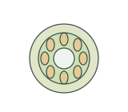](herbaceous-dicot-stem-section.svg) | [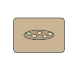](lenticel.svg) | [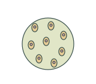](monocot-stem-section.svg) | [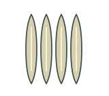](sclerenchyma-fibers.svg) |

| Stem node longitudinal section / 茎节纵切面 | Stem pith tissue / 茎髓组织 | Vascular cambium / 维管形成层 | Woody stem section / 木本植物茎横切面 |
| --- | --- | --- | --- |
| [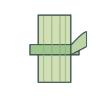](stem-node-section.svg) | [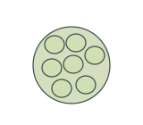](stem-pith.svg) | [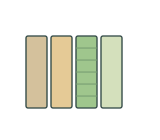](vascular-cambium.svg) | [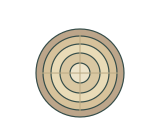](woody-stem-section.svg) |

## Use and metadata | 使用与元数据

These assets are conceptual schematics. Adapt anatomy, labels, relationships and example data to the study. 此处素材为概念示意图，使用时应结合研究核对结构、标注、关系及示例数据。

See the [icon index](../../../metadata/icon-index.csv) for source, creator, license and review status. 来源、创作者、授权与审核状态见图标索引。Assets marked `not-assigned` have no assigned reuse license. 标记为 `not-assigned` 的素材尚未确定再利用授权。
