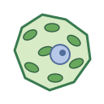
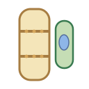
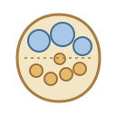

# Tissues | 组织

[All categories / 全部分类](../../README.md) · [Plant biology / 植物生物学](../README.md) · [Repository / 仓库主页](../../../README.md)

**6 editable SVGs / 6 个可编辑 SVG**

Browse tissues illustrations below. Click an image to open its editable SVG. 本目录收录组织素材，点击预览可打开 SVG 源文件。

| Bundle sheath cell / 维管束鞘细胞 | Leaf cross-section / 叶片横切面 | Mesophyll cell / 叶肉细胞 | Phloem sieve tube / 韧皮部筛管 |
| --- | --- | --- | --- |
|  |  |  |  |

| Vascular bundle / 维管束 | Xylem vessel / 木质部导管 |  |  |
| --- | --- | --- | --- |
|  |  |  |  |

## Use and metadata | 使用与元数据

These assets are conceptual schematics. Adapt anatomy, labels, relationships and example data to the study. 此处素材为概念示意图，使用时应结合研究核对结构、标注、关系及示例数据。

See the [icon index](../../../metadata/icon-index.csv) for source, creator, license and review status. 来源、创作者、授权与审核状态见图标索引。Assets marked `not-assigned` have no assigned reuse license. 标记为 `not-assigned` 的素材尚未确定再利用授权。
